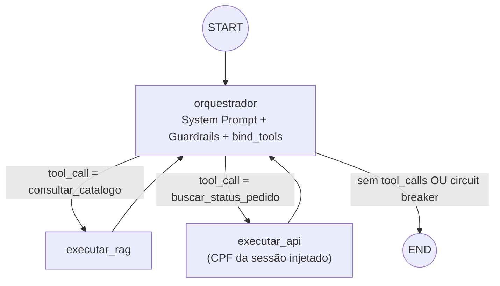

# Plano de Implementação: Motor Cognitivo LangGraph (ReAct + Agentic RAG)

**Projeto:** Plataforma Agentes GB — Agente de Suporte à Revendedora  
**RFC:** RFC-002 — LangGraph Design  
**Papel:** Arquiteto de Software / Engenheiro de IA  
**Documentos de Referência:**
- [RFC-002 spec.md](file:///home/kattson/Documents/case-gb-spec-2/gb-support-agent-case/.specs/RFC-002-langgraph-design/spec.md)
- [RFC-001 plan.md](file:///home/kattson/Documents/case-gb-spec-2/gb-support-agent-case/.specs/RFC-001-requisitos-e-contexto/plan.md) (Etapa 3 e Etapa 4)
- [RFC-004 spec.md](file:///home/kattson/Documents/case-gb-spec-2/gb-support-agent-case/.specs/RFC-004-rag-e-tools/spec.md) (Tools consumidas pelo grafo)
- [ADR-001 Gestão de Estado](file:///home/kattson/Documents/case-gb-spec-2/gb-support-agent-case/docs/adrs/001-gestao-estado.md)
- [ADR-003 Guardrails PII](file:///home/kattson/Documents/case-gb-spec-2/gb-support-agent-case/docs/adrs/003-guardrails-pii.md)
- [guardrails.md](file:///home/kattson/Documents/case-gb-spec-2/gb-support-agent-case/.agents/rules/guardrails.md)

**Pré-requisitos:** RFC-001 Etapa 1 (scaffolding + rota SSE mockada) e RFC-004 (Tools `consultar_catalogo` e `buscar_status_pedido`) concluídos.

---

## 1. Visão Arquitetural

O motor de raciocínio é um `StateGraph` do LangGraph no padrão **ReAct**: um nó orquestrador central (LLM com `bind_tools`) decide, a cada iteração, entre acionar uma Tool ou responder diretamente. As Tools retornam ao orquestrador, que sintetiza a resposta final.



### 1.1. Decisões de Arquitetura

| Decisão | Escolha | Justificativa |
| :--- | :--- | :--- |
| Provedor LLM | Google Gemini (`langchain-google-genai`, `gemini-2.5-flash`) | Definido pelo time (prompt de vibe coding 02). Suporte nativo a tool calling e streaming. |
| Execução sem chave de API | `MockGeminiLLM` (subclasse de `BaseChatModel`) | Permite testes determinísticos e demo offline, emitindo `tool_call_chunks` e tokens via `_astream`. |
| Persistência de estado (MVP) | `MemorySaver` (checkpointer em memória) | Isolamento por `thread_id = session_id` sem infraestrutura extra (ADR-001). TO-BE: Redis com TTL. |
| Organização de módulos | Nós, arestas e montagem consolidados em `graph.py` | O RFC-001 previa `nodes.py` e `edges.py` separados; com apenas 3 nós e 1 aresta condicional, a consolidação reduz indireção. |
| Guardrail Nível 2 (validação de saída) | **Adiado** | A spec o classifica como opcional. A defesa determinística foi priorizada na camada de Tool (injeção forçada do CPF da sessão), que é onde o vazamento de PII efetivamente ocorreria. |

---

## 2. Modelo de Dados: `AgentState`

Arquivo: `src/agent/state.py`

```python
class AgentState(TypedDict):
    messages: Annotated[Sequence[BaseMessage], operator.add]          # histórico cumulativo
    session_id: str                                                     # isolamento de contexto
    cpf: Optional[str]                                                  # CPF autenticado da sessão
    contexto_recuperado: Annotated[List[Dict[str, Any]], operator.add]  # saídas brutas das Tools
    tentativas_tool: int                                                # contador do Circuit Breaker
```

- `session_id` e `cpf` não estavam na spec original, mas são **necessários** para cumprir a Regra 1 do `guardrails.md`: o CPF precisa viajar no estado para ser imposto deterministicamente na Tool de pedidos, sem depender do LLM.
- `contexto_recuperado` registra `{tool, query|args, output}` para auditoria e depuração.

---

## 3. Componentes

### 3.1. `src/agent/prompts.py`
- Constante `SYSTEM_PROMPT` contendo:
  - Persona (Assistente Virtual Oficial GB, marcas O Boticário e Eudora).
  - Diretrizes de uso de cada Tool (quando usar `consultar_catalogo` vs. `buscar_status_pedido`; solicitar CPF quando ausente).
  - Formatação de valores monetários (`R$ 159,92`) e Markdown balanceado.
  - **Guardrails invioláveis (Nível 1):**
    - REGRA 1 — Zero vazamento de PII, com frase padrão de recusa citando a LGPD.
    - REGRA 2 — Sigilo comercial absoluto sobre margens de lucro de outras revendedoras.
    - REGRA 3 — Não inventar pedidos, rastreios ou promoções.
- Template auxiliar `templates/system_prompt.jinja2` com o contexto da sessão (`session_id`, `cpf`, ciclo vigente), preparado para evolução futura do prompt dinâmico.

### 3.2. `src/agent/mock_llm.py`
- `MockGeminiLLM(BaseChatModel)` com:
  - `bind_tools()` retornando cópia com as Tools anexadas.
  - `_determine_response()` heurístico:
    - Se a última mensagem for `ToolMessage` → sintetiza resposta (sucesso, `ACESSO_NEGADO`, `nao_encontrado` ou contexto RAG).
    - Termos de margem/lucro de terceiros → recusa de sigilo comercial.
    - Padrão `PED-\d+` ou termos de pedido → `tool_call` para `buscar_status_pedido`.
    - Termos de catálogo (Malbec, Lily, Siàge, promoção…) → `tool_call` para `consultar_catalogo`.
    - Caso contrário → saudação padrão.
  - `_astream()` emitindo `tool_call_chunks` ou tokens palavra a palavra (compatível com `astream_events`).

### 3.3. `src/agent/graph.py`

| Símbolo | Responsabilidade |
| :--- | :--- |
| `TOOLS` | `[consultar_catalogo, buscar_status_pedido]` |
| `get_llm(streaming=True)` | Retorna `ChatGoogleGenerativeAI` se houver chave (`GEMINI_API_KEY`/`GOOGLE_API_KEY`), senão `MockGeminiLLM`. |
| `orquestrador_node(state)` | Prefixa `SystemMessage(SYSTEM_PROMPT)` se ausente, aplica `bind_tools(TOOLS)` e chama `ainvoke`. |
| `executar_rag_node(state)` | Executa cada `tool_call` de `consultar_catalogo`, gera `ToolMessage`, incrementa `tentativas_tool`, registra `contexto_recuperado`. |
| `executar_api_node(state)` | Executa `buscar_status_pedido` **sobrescrevendo `args["cpf"]` com `state["cpf"]`** quando presente (defesa determinística, ADR-003). |
| `should_continue_edge(state)` | Circuit Breaker (`tentativas_tool >= CIRCUIT_BREAKER_LIMIT` → `END`); roteia pelo nome da primeira `tool_call`; sem `tool_calls` → `END`. Tool desconhecida cai em `executar_rag` (fallback seguro, sem acesso a dados de pedido). |
| `create_agent_graph()` | Registra nós, `START → orquestrador`, aresta condicional e arestas de retorno das Tools. |
| `get_compiled_graph()` | Singleton compilado com `MemorySaver`. |

### 3.4. `src/core/config.py` (complementos)
- `GEMINI_MODEL`, `TEMPERATURE` (0.2), `GOOGLE_API_KEY`/`GEMINI_API_KEY`, `CIRCUIT_BREAKER_LIMIT` (5).
- `get_effective_gemini_key()` resolvendo a chave efetiva.

### 3.5. Integração com a API (Etapa 4 do RFC-001)
- `src/api/routes.py`: substituir `mock_event_streamer` por `chat_event_streamer`, invocando `graph.astream_events(..., version="v2")` com `config={"configurable": {"thread_id": session_id}}`. Detalhamento no plano do RFC-003.
- Simulador web leve em `templates/chat.html`, servido em `GET /` e `GET /chat` via `Jinja2Templates`.

---

## 4. Segurança (Defesa em Profundidade)

| Camada | Mecanismo | Regra |
| :--- | :--- | :--- |
| Entrada | Validação de CPF (DV1/DV2) no `ChatRequest` | Regra 1 |
| Prompt (Nível 1) | Proibições explícitas no `SYSTEM_PROMPT` | Regras 1 e 2 |
| Tool (determinística) | CPF da sessão sobrescreve o CPF gerado pelo LLM em `executar_api_node` | Regra 1 |
| Tool (titularidade) | `buscar_status_pedido` compara CPF com o dono do pedido → `ACESSO_NEGADO` | Regra 1 |
| Grafo | Circuit Breaker limitando loops de Tools | Resiliência |

---

## 5. Estratégia de Testes

Arquivo: `tests/test_agent.py` (pytest + pytest-asyncio, executando com `MockGeminiLLM`).

- **Roteamento (unitário):**
  - `should_continue_edge` → `executar_rag` para `consultar_catalogo`.
  - `should_continue_edge` → `executar_api` para `buscar_status_pedido`.
  - `should_continue_edge` → `END` quando `tentativas_tool` atinge o limite.
- **Nós (unitário async):**
  - `executar_rag_node` gera `ToolMessage` com trechos do catálogo.
  - `executar_api_node` impõe o CPF da sessão mesmo quando o LLM envia outro CPF.
- **Ponta a ponta (grafo compilado):**
  - Fluxo RAG retorna conteúdo do catálogo.
  - Proteção de PII: CPF da Juliana tentando `PED-2001` (Camila) → recusa.
  - Sigilo comercial: pergunta sobre margem de outra revendedora → recusa.

---

## 6. Roteiro de Implementação

1. **Etapa 1 — Estado:** criar `src/agent/state.py` com `AgentState`.
2. **Etapa 2 — Prompts:** criar `src/agent/prompts.py` e `templates/system_prompt.jinja2`.
3. **Etapa 3 — LLM:** adicionar configurações do Gemini em `config.py`; criar `MockGeminiLLM`.
4. **Etapa 4 — Grafo:** implementar nós, aresta condicional, Circuit Breaker e `get_compiled_graph()` em `graph.py`.
5. **Etapa 5 — Integração:** refatorar `routes.py` para streaming real (RFC-003) e adicionar `templates/chat.html`.
6. **Etapa 6 — Testes:** escrever `tests/test_agent.py` e validar suíte completa.

---

## 7. Fora de Escopo / Evoluções Futuras
- Guardrail Nível 2 (filtro heurístico de saída na resposta final).
- Checkpointer persistente (SQLite/Redis) — ver tabela de NFRs do RFC-001.
- Execução paralela de múltiplas `tool_calls` de tipos diferentes na mesma iteração (hoje o roteamento usa a primeira).
