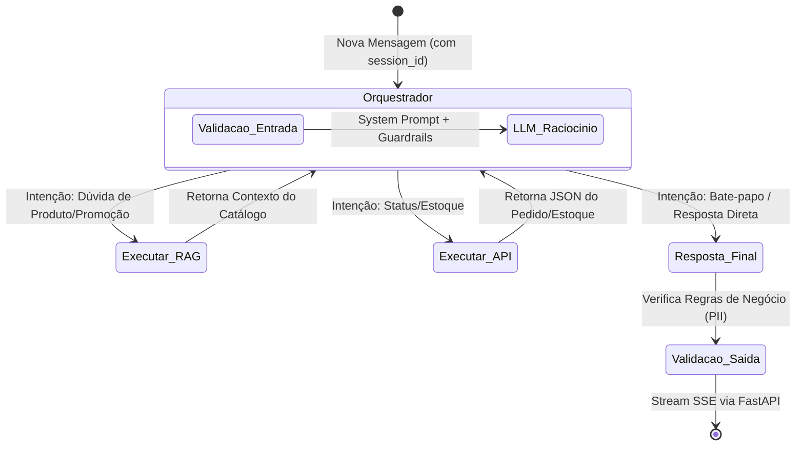

# LangGraph Architecture & Graph Design
**Projeto:** Agente de Suporte à Revendedora (Plataforma Agentes GB)

**Propósito deste Documento:** Detalhar a arquitetura do motor de raciocínio (StateGraph) e servir como contexto de *Vibe Coding* para a geração dos nós, arestas e estado da aplicação.

## 1. Padrão Arquitetural
O agente utilizará o padrão **ReAct (Reasoning and Acting) com Agentic RAG**. Em vez de fluxos procedurais rígidos, o LLM atuará como o nó orquestrador central. A busca de catálogo (RAG) e a consulta de pedidos (API) serão expostas ao LLM como *Tools* independentes.

## 2. Diagrama de Estados do Grafo (Mermaid)

## 3. Gestão de Estado (State)
A memória da execução isolará o contexto da conversa por revendedora (`session_id` ou `thread_id`). 

*   **Estrutura Base (`AgentState`):** O estado deve herdar um `TypedDict` contendo o histórico das mensagens.
*   **Campos Necessários:**
    *   `messages`: Lista de mensagens (anotada com `operator.add` para apensamento contínuo).
    *   `contexto_recuperado`: Armazenamento temporário de resultados brutos das Tools.
    *   `tentativas_tool`: Contador numérico para atuar como *Circuit Breaker* (limite de loops).

## 4. Definição dos Nós (Nodes)
Cada nó representa uma função assíncrona executável no fluxo:

1.  **`Orquestrador`:**
    *   Avalia o estado atual da conversa.
    *   Injeta o *System Prompt* contendo a instrução estrita de segurança e o contexto comercial.
    *   Invoca o modelo generativo com as ferramentas anexadas (`bind_tools`).
2.  **`Executar_RAG` (Tool Contextual):**
    *   Recebe a intenção de consulta de produto do Orquestrador.
    *   Conecta ao Vector Store local.
    *   Executa busca semântica na base sintética do Catálogo do Ciclo 15.
    *   Retorna os chunks de texto relevantes para o estado.
3.  **`Executar_API` (Tool Transacional):**
    *   Recebe os argumentos extraídos (ex: `cpf`, `id_pedido`).
    *   Simula a requisição para a API mockada de pedidos/estoque e retorna o payload JSON consolidado.

## 5. Arestas Condicionais (Conditional Edges)
A função de roteamento `should_continue(state)` decidirá o próximo passo baseada na última mensagem gerada pelo Orquestrador:
*   **Condição 1:** Se a mensagem possuir `tool_calls` e o nome da tool for referente ao catálogo, segue para `Executar_RAG`.
*   **Condição 2:** Se possuir `tool_calls` para pedidos/estoque, segue para `Executar_API`.
*   **Condição 3:** Se NÃO houver `tool_calls`, encerra o grafo iterativo e segue para a `Resposta_Final` (via Streaming SSE).

## 6. Camada de Segurança (Guardrails)
Para atender à exigência de proteção de dados, implementaremos Defesa em Profundidade em dois níveis de fluxo:
*   **Nível 1 (Prompt):** O `System Prompt` do Orquestrador deve conter uma proibição absoluta de fornecer ou calcular margens de lucro de outras revendedoras e regras rígidas sobre manipulação de Dados Pessoais (PII).
*   **Nível 2 (Validação Opcional de Saída):** Filtro heurístico rápido na `Resposta_Final` antes de encaminhar o texto em streaming pelo endpoint do FastAPI.