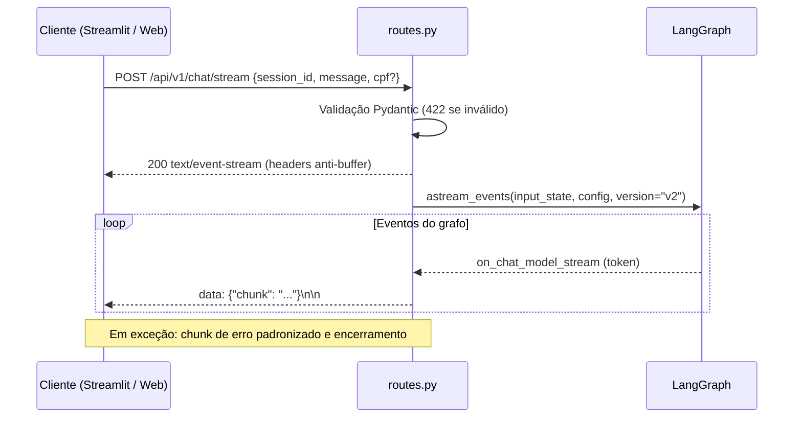

# Plano de Implementação: API FastAPI e Streaming SSE

**Projeto:** Plataforma Agentes GB — Agente de Suporte à Revendedora  
**RFC:** RFC-003 — API e Streaming  
**Papel:** Engenheiro de Software Backend  
**Documentos de Referência:**
- [RFC-003 spec.md](file:///home/kattson/Documents/case-gb-spec-2/gb-support-agent-case/.specs/RFC-003-api-e-streaming/spec.md)
- [RFC-001 plan.md](file:///home/kattson/Documents/case-gb-spec-2/gb-support-agent-case/.specs/RFC-001-requisitos-e-contexto/plan.md) (Seções 3.1, 3.2 e Etapas 1 e 4)
- [ADR-002 Streaming SSE](file:///home/kattson/Documents/case-gb-spec-2/gb-support-agent-case/docs/adrs/002-streaming-sse.md)
- [guardrails.md](file:///home/kattson/Documents/case-gb-spec-2/gb-support-agent-case/.agents/rules/guardrails.md) (Regra 3 — SSE nativo)

---

## 1. Visão Arquitetural

A API é a camada de transporte: valida o contrato de entrada, delega a execução ao grafo LangGraph e converte os eventos internos em um fluxo SSE contendo **apenas tokens de texto** destinados à interface.

### 1.1. Decisões de Arquitetura

| Decisão | Escolha | Justificativa |
| :--- | :--- | :--- |
| Implementação em duas fases | Fase A: gerador mock; Fase B: grafo real | Validar contrato e transporte SSE isoladamente antes de acoplar o LLM (prompt de vibe coding 03). |
| Versão de eventos | `astream_events(version="v2")` | A `v1` citada na spec está depreciada no LangGraph atual; `v2` mantém o evento `on_chat_model_stream`. |
| Filtro de eventos | Apenas `on_chat_model_stream` com conteúdo textual | Descarta eventos de roteamento, chunks de `tool_call` e saídas de Tools. |
| Erros após início do stream | Chunk SSE de erro em vez de `HTTPException` | Depois que o status 200 e os headers foram enviados, não é possível alterar o código HTTP. `HTTPException` fica restrito à fase de validação (422). |
| Circuit Breaker | Encerrado dentro do grafo (aresta → `END`) | O limite é aplicado em `should_continue_edge` (RFC-002); a API apenas finaliza o stream normalmente. |
| `extra="forbid"` no `ChatRequest` | Ativado | Impede injeção de campos não previstos no contrato. |

---

## 2. Contratos de Dados

Arquivo: `src/api/schemas.py`

### 2.1. `ChatRequest`
| Campo | Tipo | Regras |
| :--- | :--- | :--- |
| `session_id` | `str` | Obrigatório; `strip()`; não vazio; mínimo 3 caracteres. |
| `message` | `str` | Obrigatório; `min_length=1`, `max_length=4000`; `strip()`; não vazia. |
| `cpf` | `Optional[str]` | Normaliza removendo não-dígitos; exige 11 dígitos; rejeita sequências repetidas; valida DV1 e DV2 (Receita Federal). |

- Função auxiliar `_clean_and_validate_cpf()` isolada para reuso e teste.
- O limite de `message` foi ampliado de 2000 (RFC-001) para 4000 caracteres para acomodar mensagens longas coladas pela revendedora.

### 2.2. `ChatStreamChunk`
- `chunk: str`
- `to_sse() -> str` → `data: {"chunk": "..."}\n\n` com `json.dumps(..., ensure_ascii=False)` para preservar acentuação.

### 2.3. `ErrorResponse`
- `detail: str`, `code: Optional[str]` (ex.: `INVALID_CPF`, `GUARDRAIL_VIOLATION`).

---

## 3. Endpoint e Gerador

Arquivo: `src/api/routes.py`

### 3.1. Rota
- `router = APIRouter(prefix="/api/v1", tags=["Chat"])`
- `POST /chat/stream` → `StreamingResponse(media_type="text/event-stream")`
- Headers: `Content-Type: text/event-stream; charset=utf-8`, `Cache-Control: no-cache`, `Connection: keep-alive`, `X-Accel-Buffering: no`.
- Documentação OpenAPI com respostas `200` (SSE) e `422` (validação).

### 3.2. Fase A — `mock_event_streamer(request)`
- Emite "Teste de streaming SSE" palavra por palavra com `asyncio.sleep(0.5)`.
- Objetivo: validar headers, formato e consumo pelo cliente. Removido na Fase B.

### 3.3. Fase B — `chat_event_streamer(request)`
1. Obtém `get_compiled_graph()`.
2. Monta `input_state` com `HumanMessage(message)`, `session_id`, `cpf`, `contexto_recuperado=[]`, `tentativas_tool=0`.
3. Monta `config` com `configurable.thread_id = session_id` (isolamento de memória) e `callbacks` (ver RFC-006).
4. Itera `astream_events`, filtrando `on_chat_model_stream`:
   - `content` string → um chunk.
   - `content` lista de blocos (formato Gemini) → um chunk por bloco com `text`.
5. Sanitiza cada chunk escapando `$` (`_sanitize_markdown_chunk`) para que valores `R$` não sejam interpretados como LaTeX/KaTeX pelos renderizadores Markdown.
6. Em exceção: loga com `exc_info` e emite `data: {"chunk": "\n\n[Erro no processamento da solicitação: ...]"}\n\n`.

### 3.4. Aplicação e rotas auxiliares
- `src/main.py`: `FastAPI` com CORS liberado (simulador), inclusão de `router` e `web_router`, `GET /health`.
- `web_router`: `GET /` e `GET /chat` renderizando `templates/chat.html`.
- `__getattr__("app")` em `routes.py` para permitir `uvicorn src.api.routes:app` (exigência do Dockerfile, RFC-006).

---

## 4. Estratégia de Testes

Arquivo: `tests/test_api.py` (`fastapi.testclient.TestClient`, LLM mock).

- **Schema:**
  - Requisição válida sem CPF; com CPF formatado (normalização).
  - `session_id` vazio e curto → erro.
  - `message` vazia → erro.
  - CPF com dígitos repetidos, DV incorreto e tamanho inválido → erro.
- **Chunk:** `to_sse()` gera o formato exato `data: {...}\n\n`.
- **Rotas:**
  - `GET /health` → `{"status": "ok"}`.
  - `GET /` → HTML do simulador.
  - Stream RAG: `200`, `text/event-stream`, `cache-control: no-cache`, chunks com conteúdo do catálogo.
  - Stream de pedido com CPF válido.
  - Stream com pergunta de margem de lucro → recusa de sigilo comercial.
  - CPF inválido e `session_id` ausente → `422`.

---

## 5. Roteiro de Implementação

1. **Fase A (contratos e transporte):**
   - `schemas.py` completo; `routes.py` com `mock_event_streamer`; `main.py` com CORS e health.
   - Validar via `curl -N` e testes de schema.
2. **Fase B (integração real, após RFC-002 e RFC-004):**
   - Substituir o mock por `chat_event_streamer` com `astream_events(version="v2")`.
   - Adicionar sanitização de `$` e chunk de erro padronizado.
   - Adicionar rotas do simulador web.
   - Atualizar testes de rota para os fluxos RAG, pedido e guardrail.

---

## 6. Fora de Escopo / Evoluções Futuras
- Timeout explícito por Tool/RAG no servidor (hoje o limite efetivo é o timeout de 60s do cliente).
- Evento de encerramento explícito (`{"chunk": "", "done": true}`) previsto no RFC-001 — o fim do stream é sinalizado pelo fechamento da conexão.
- Uso de `ErrorResponse` como corpo padronizado de todas as respostas de erro.
