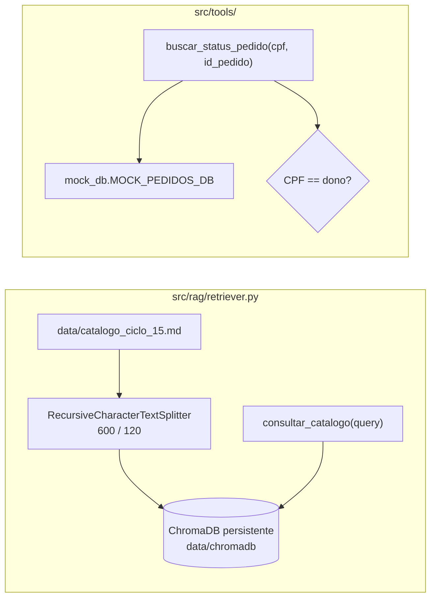

# Plano de Implementação: RAG do Catálogo e Tools Transacionais

**Projeto:** Plataforma Agentes GB — Agente de Suporte à Revendedora  
**RFC:** RFC-004 — RAG e Tools  
**Papel:** Engenheiro de IA / Backend  
**Documentos de Referência:**
- [RFC-004 spec.md](file:///home/kattson/Documents/case-gb-spec-2/gb-support-agent-case/.specs/RFC-004-rag-e-tools/spec.md)
- [RFC-001 plan.md](file:///home/kattson/Documents/case-gb-spec-2/gb-support-agent-case/.specs/RFC-001-requisitos-e-contexto/plan.md) (Etapa 2)
- [ADR-003 Guardrails PII](file:///home/kattson/Documents/case-gb-spec-2/gb-support-agent-case/docs/adrs/003-guardrails-pii.md)
- [ADR-004 Estratégia de RAG](file:///home/kattson/Documents/case-gb-spec-2/gb-support-agent-case/docs/adrs/004-rag-strategy.md)
- [guardrails.md](file:///home/kattson/Documents/case-gb-spec-2/gb-support-agent-case/.agents/rules/guardrails.md) (Regra 1)

**Natureza:** sub-tarefa independente do grafo — os conectores são implementados e testados isoladamente antes da integração no RFC-002.

---

## 1. Visão Arquitetural

### 1.1. Decisões de Arquitetura

| Decisão | Escolha | Justificativa |
| :--- | :--- | :--- |
| Vector Store | `chromadb.PersistentClient` em `data/chromadb` | Persistência em disco sem serviço externo; montável como volume Docker (RFC-006). |
| Embeddings | `SentenceTransformerEmbeddingFunction("all-MiniLM-L6-v2")` nativa do ChromaDB | Local e gratuito, como exige a spec; usar a função nativa evita a dependência extra `langchain-huggingface`. |
| Métrica | `hnsw:space = cosine` | Adequada a embeddings normalizados de sentence-transformers. |
| Chunking | `chunk_size=600`, `chunk_overlap=120`, separadores `["\n## ", "\n### ", "\n\n", "\n", " "]`, `keep_separator=True` | Respeita a hierarquia Markdown do catálogo: cada chunk tende a conter um produto completo com seu cabeçalho. |
| Ingestão | Idempotente e preguiçosa (somente se `collection.count() == 0`) | Evita reindexação a cada boot e duplicação de chunks. |
| Cache | Singleton `_collection_instance` | Evita recarregar o modelo de embeddings a cada consulta. |
| Erro de acesso na Tool | Retornar JSON estruturado (`status`/`codigo`) em vez de lançar exceção | Uma exceção interromperia o grafo; o JSON permite que o LLM explique a recusa de forma polida, mantendo o bloqueio determinístico. |

---

## 2. Base Sintética do Catálogo

Arquivo: `data/catalogo_ciclo_15.md`

- Cabeçalho: vigência (01/10 a 31/10/2026), público, condições comerciais (pedido mínimo, frete grátis).
- Seções `##` / `###`:
  1. Perfumaria Masculina O Boticário (Malbec, Malbec Gold, Malbec Bleu, Arbo).
  2. Perfumaria Feminina O Boticário (Lily, Floratta).
  3. Eudora (Perfumaria Fina, Siàge).
  4. Maquiagem (Make B., Niina Secrets).
  5. Cuidados Corporais e Skincare (Nativa SPA, Botik).
  6. Quadro Resumo de Promoções.
- Cada produto com código (`BOT-1001`…), descrição, preço regular, preço/promoção do ciclo e pontuação.
- Promoções obrigatórias: **"Desconto de 20% no Malbec"** e **"Combo Lily por R$ 199"**.

---

## 3. Pipeline de RAG

Arquivo: `src/rag/retriever.py`

| Símbolo | Responsabilidade |
| :--- | :--- |
| `CatalogQueryInput` | Schema Pydantic (`query: str`) exposto ao LLM. |
| `_get_embedding_function()` | Instancia a função de embedding local. |
| `ingest_catalog(collection, catalog_path, chunk_size, chunk_overlap) -> int` | Lê o Markdown, faz o split e indexa com ids `chunk_0000…` e metadados `source`/`chunk_index`. Lança `FileNotFoundError` se o catálogo não existir. |
| `get_or_create_vectorstore(persist_directory, catalog_path)` | Cria o diretório, o client persistente e a coleção `catalogo_ciclo_15`; dispara a ingestão se vazia. |
| `_consultar_catalogo_core(query, k=3) -> str` | Busca top-K; retorna blocos `--- Trecho do Catálogo [i] ---`; trata query vazia e ausência de resultados. |
| `consultar_catalogo` | `@tool("consultar_catalogo", args_schema=CatalogQueryInput)` com a descrição da spec. |

---

## 4. Tool Transacional de Pedidos

### 4.1. `src/tools/mock_db.py`
- `MOCK_PEDIDOS_DB: Dict[str, Dict[str, Any]]` indexado por `id_pedido`, com duas revendedoras de CPFs válidos:
  - Juliana Silveira (`52998224725`): `PED-1001` (em transporte), `PED-1002` (entregue).
  - Camila Guimarães (`14183884784`): `PED-2001` (faturado), `PED-2002` (em separação).
- Campos: `status_entrega`, `data_previsao`, `transportadora`, `codigo_rastreio`, `itens`, `valor_total`, `nota_fiscal`, `data_entrega_efetiva` (opcional).
- `get_mock_pedido(id_pedido)` case-insensitive.

### 4.2. `src/tools/order_status.py`
- `OrderStatusInput`: `cpf: str`, `id_pedido: str`.
- `_buscar_status_pedido_core(cpf, id_pedido) -> str` (JSON):

| Situação | Resposta |
| :--- | :--- |
| CPF vazio após sanitização | `{"status": "erro", "codigo": "CPF_INVALIDO"}` |
| Pedido inexistente | `{"status": "nao_encontrado", "id_pedido": ...}` |
| CPF ≠ dono do pedido | `{"status": "erro", "codigo": "ACESSO_NEGADO", "mensagem": "...LGPD..."}` |
| CPF = dono | `{"status": "sucesso", ...}` com dados de rastreio e nota fiscal |

- **Regra 1 (Zero Vazamento de PII):** a resposta de `ACESSO_NEGADO` não contém nenhum dado do pedido nem da titular (nome, itens, valores).
- O campo `revendedora_nome` do mock nunca é retornado.
- `buscar_status_pedido`: `@tool` com a descrição definida no RFC-001.

---

## 5. Estratégia de Testes

Arquivo: `tests/test_tools_and_rag.py`

- **Tool de pedidos:**
  - Pedido próprio → `sucesso` com campos de rastreio.
  - Acesso cruzado (CPF Juliana → `PED-2001`) → `ACESSO_NEGADO`, sem dados vazados.
  - Pedido inexistente → `nao_encontrado`.
  - CPF vazio → `CPF_INVALIDO`.
  - Invocação via interface LangChain (`.invoke({...})`).
- **RAG:**
  - "promoção Malbec" retorna o desconto de 20%.
  - "Combo Lily" retorna o combo de R$ 199.
  - "Eudora Siàge" retorna a linha capilar.
  - Query vazia → mensagem padronizada.
  - Invocação via interface LangChain.

---

## 6. Roteiro de Implementação

1. Gerar `data/catalogo_ciclo_15.md` com estrutura hierárquica e promoções obrigatórias.
2. Implementar `src/tools/mock_db.py` e `src/tools/order_status.py`.
3. Implementar `src/rag/retriever.py` (ingestão, coleção, Tool).
4. Executar a primeira ingestão e versionar `data/chromadb/` para acelerar o boot da demo.
5. Escrever e rodar `tests/test_tools_and_rag.py`.

---

## 7. Fora de Escopo / Evoluções Futuras
- Consulta de estoque (citada na spec do RFC-001) — sem Tool dedicada no MVP.
- Re-ranking, busca híbrida (BM25 + vetorial) e filtros por metadados de seção.
- Reindexação automática ao detectar alteração do catálogo (hash do arquivo).
