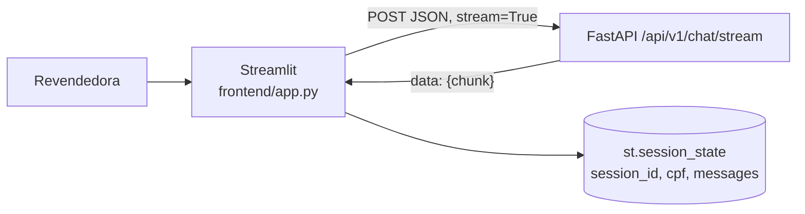

# Plano de Implementação: Interface de Simulação em Streamlit

**Projeto:** Plataforma Agentes GB — Agente de Suporte à Revendedora  
**RFC:** RFC-005 — Frontend  
**Papel:** Engenheiro Full Stack Python  
**Documentos de Referência:**
- [RFC-005 spec.md](file:///home/kattson/Documents/case-gb-spec-2/gb-support-agent-case/.specs/RFC-005-frontend/spec.md)
- [RFC-003 plan.md](file:///home/kattson/Documents/case-gb-spec-2/gb-support-agent-case/.specs/RFC-003-api-e-streaming/plan.md) (contrato SSE consumido)

**Pré-requisito:** endpoint `POST /api/v1/chat/stream` funcional (RFC-003 Fase B).

---

## 1. Visão Arquitetural

O frontend é um cliente fino e desacoplado (pasta `frontend/` com dependências próprias), que simula o canal de atendimento da revendedora e consome o stream SSE da API.

### 1.1. Decisões de Arquitetura

| Decisão | Escolha | Justificativa |
| :--- | :--- | :--- |
| Renderização incremental | `st.write_stream(generator)` | Substitui o placeholder manual (`st.empty()`) citado na spec com API nativa equivalente, retornando o texto completo para persistência. |
| Parsing SSE | `response.iter_lines(decode_unicode=True)` + remoção do prefixo `data: ` + `json.loads` | Formato definido no RFC-003; fallback para texto bruto se o JSON falhar. |
| Escape de `$` | `escape_markdown_dollars()` em chunks, histórico e input | O Streamlit interpreta `$...$` como LaTeX, fazendo valores `R$` desaparecerem (correção do PR #6). Regex com lookbehind garante idempotência. |
| URL da API | `API_URL` via variável de ambiente, com override na sidebar | Suporta execução local (`localhost:8000`) e Docker (`http://api:8000`); a função completa o path quando recebe só a base. |
| CPF padrão | `529.982.247-25` pré-preenchido | Facilita a demo com uma revendedora que possui pedidos no mock. |

---

## 2. Estado da Sessão (`st.session_state`)

| Chave | Valor inicial | Uso |
| :--- | :--- | :--- |
| `session_id` | `revendedora-<uuid[:8]>` | Enviado em toda requisição; regenerado ao limpar histórico. |
| `messages` | Mensagem de boas-vindas da assistente | Histórico do lado do cliente, re-renderizado a cada rerun. |
| `cpf` | `529.982.247-25` | Identidade simulada; enviado no payload (ou `None` se vazio). |

---

## 3. Componentes

### 3.1. `frontend/app.py`
- **Configuração:** `st.set_page_config` (título, ícone 💄, layout wide) e CSS com a identidade verde O Boticário.
- **`stream_chat_response(api_url, session_id, message, cpf) -> Generator[str]`:**
  - `requests.post(..., stream=True, timeout=60)`.
  - `422` → mensagem amigável com o `detail` da validação.
  - Outros status ≠ 200 → mensagem com código e corpo.
  - `ConnectionError` → instrução para subir o backend com `uvicorn`.
  - `Timeout` e exceções genéricas → mensagens padronizadas.
- **Sidebar "Configuração da Sessão":**
  - Input de CPF (simulação de autenticação).
  - Exibição do `session_id`.
  - Expander com a URL da API.
  - Botão "Limpar Histórico / Nova Sessão" → novo `session_id`, reset de `messages`, `st.rerun()`.
  - Sugestões de teste (RAG, combo, pedido próprio, teste de PII, teste de sigilo comercial).
- **Área principal:** cabeçalho com badge do Ciclo 15, `st.chat_message` para o histórico e `st.chat_input` para novas mensagens.

### 3.2. `frontend/requirements.txt`
- Apenas `streamlit` e `requests`.

### 3.3. `frontend/Dockerfile` (consumido pelo RFC-006)
- `python:3.11-slim`, porta `8501`, `streamlit run app.py --server.port=8501 --server.address=0.0.0.0`.

---

## 4. Estratégia de Testes

Arquivo: `tests/test_frontend.py` (`unittest.mock.patch` sobre `requests.post`, sem servidor real).

- **`stream_chat_response`:**
  - Sucesso: linhas SSE são convertidas nos chunks esperados.
  - `ConnectionError` → mensagem de erro de conexão.
  - `422` → mensagem de validação.
  - Chunks com `R$` são escapados.
- **`escape_markdown_dollars`:**
  - Preços em reais são escapados.
  - Texto já escapado permanece idêntico (idempotência).
  - String vazia ou `None` → `""`.

---

## 5. Roteiro de Implementação

1. Criar `frontend/requirements.txt`.
2. Implementar `frontend/app.py` (estado, sidebar, função de streaming, chat).
3. Escrever `tests/test_frontend.py`.
4. Validar manualmente com `streamlit run frontend/app.py` contra a API local.
5. **Correção (PR #6):** adicionar `escape_markdown_dollars` após detectar sumiço dos valores `R$` na renderização.

---

## 6. Fora de Escopo / Evoluções Futuras
- Autenticação real da revendedora (o CPF da sidebar é apenas simulação).
- Persistência do histórico no servidor para reidratar a conversa após recarregar a página.
- Validação de CPF no cliente antes do envio (hoje delegada ao `422` da API).
