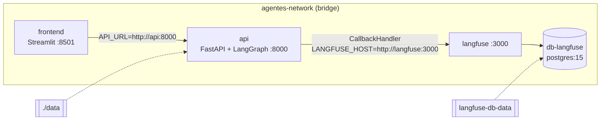

# Plano de Implementação: Observabilidade (LangFuse) e Infraestrutura Docker

**Projeto:** Plataforma Agentes GB — Agente de Suporte à Revendedora  
**RFC:** RFC-006 — Observabilidade e LLMOps  
**Papel:** Engenheiro DevOps / LLMOps  
**Documentos de Referência:**
- [RFC-006 spec.md](file:///home/kattson/Documents/case-gb-spec-2/gb-support-agent-case/.specs/RFC-006-observabilidade/spec.md)
- [RFC-003 plan.md](file:///home/kattson/Documents/case-gb-spec-2/gb-support-agent-case/.specs/RFC-003-api-e-streaming/plan.md) (ponto de injeção dos callbacks)
- [ADR-005 LLMOps](file:///home/kattson/Documents/case-gb-spec-2/gb-support-agent-case/docs/adrs/005-llmops.md)

**Escopo adicional:** a spec pressupõe que a API e o LangFuse estejam na mesma rede Docker. Como não havia RFC próprio para containerização, a dockerização da aplicação (prompt de vibe coding 06) é tratada aqui como **Fase 1**, pré-requisito da observabilidade.

---

## 1. Visão Arquitetural

### 1.1. Decisões de Arquitetura

| Decisão | Escolha | Justificativa |
| :--- | :--- | :--- |
| Acoplamento | Callback injetado por requisição no `config`, nunca dentro dos nós | Exigência da spec; mantém o grafo agnóstico à telemetria. |
| Versão do SDK | `langfuse>=2.50,<3.0` e imagem `langfuse/langfuse:2` | O SDK 3.x mudou a API de `CallbackHandler` (baseado em OpenTelemetry); servidor e SDK foram fixados na mesma major para garantir compatibilidade. |
| Compatibilidade LangChain | Shims em `sys.modules` (`langchain.callbacks.base`, `langchain.schema.*`) | O handler do Langfuse 2.x importa caminhos legados removidos no LangChain 0.2+/1.x. |
| Degradação graciosa | Sem chaves ou falha de inicialização → handler `None` + `warning` | Observabilidade nunca pode derrubar o atendimento. |
| Envio de traces | `flush()` no `finally` do gerador SSE | Garante que traces de streams curtos sejam enviados antes do fim da requisição. |
| Persistência | Volume `./data:/app/data` (API) e volume nomeado (Postgres) | Preserva ChromaDB, catálogo e traces entre recriações dos containers. |

---

## 2. Fase 1 — Dockerização da Aplicação

### 2.1. `.dockerignore`
- Ignora `__pycache__`, `.venv`, `.git`, IDEs, caches de teste, logs, `.env*` (exceto `.env.example`) e `*.sqlite3`, **preservando `data/**`**.

### 2.2. `Dockerfile` (API, raiz)
- `python:3.11-slim`; `PYTHONDONTWRITEBYTECODE=1`, `PYTHONUNBUFFERED=1`.
- Instala `build-essential` e `curl` (necessário ao healthcheck).
- Instala `requirements.txt`; copia `src/`, `data/` e `templates/`.
- `EXPOSE 8000`; `CMD uvicorn src.api.routes:app --host 0.0.0.0 --port 8000` (resolvido via `__getattr__` em `routes.py`).

### 2.3. `frontend/Dockerfile`
- `python:3.11-slim`; instala `frontend/requirements.txt`; copia `app.py`; `EXPOSE 8501`.

### 2.4. `run.sh`
- `docker-compose up -d --build` seguido de `docker-compose logs -f`.

---

## 3. Fase 2 — Stack de Observabilidade

### 3.1. `docker-compose.yml` (4 serviços)

| Serviço | Imagem / Build | Porta | Dependência | Destaques |
| :--- | :--- | :--- | :--- | :--- |
| `db-langfuse` | `postgres:15` | — | — | `POSTGRES_DB=langfuse`; healthcheck `pg_isready`. |
| `langfuse` | `langfuse/langfuse:2` | 3000 | `db-langfuse` (healthy) | `DATABASE_URL`, `NEXTAUTH_URL`, `NEXTAUTH_SECRET`, `SALT`, `TELEMETRY_ENABLED=false`. |
| `api` | build `.` | 8000 | `langfuse` | `env_file: .env`; chaves LangFuse com default (`pk-lf-…`/`sk-lf-…`) sobrescrevível; healthcheck em `/health`. |
| `frontend` | build `./frontend` | 8501 | `api` (healthy) | `API_URL=http://api:8000`. |

- Rede `agentes-network` (bridge) e volume nomeado `langfuse-db-data`.
- Healthchecks encadeados garantem a ordem de subida.

### 3.2. Instrumentação em `src/api/routes.py`

| Função | Responsabilidade |
| :--- | :--- |
| `_setup_langchain_compat()` | Registra os módulos legados esperados pelo SDK 2.x. |
| `_get_langfuse_callback(session_id, user_id)` | Lê `LANGFUSE_PUBLIC_KEY`, `LANGFUSE_SECRET_KEY`, `LANGFUSE_HOST`; instancia `langfuse.callback.CallbackHandler` com `session_id` e `user_id`. |
| `_flush_langfuse(handler)` | Faz flush tolerante a variações de API do SDK. |

- Em `chat_event_streamer`:
  - `config["callbacks"] = [handler]` quando disponível.
  - `config["metadata"]` com `langfuse_session_id`, `langfuse_user_id` e `langfuse_trace_name="gb-support-agent-chat"`.
  - `user_id` = CPF normalizado pelo `ChatRequest` e **pseudonimizado** por `src.core.security.pseudonimizar_cpf` (HMAC-SHA256 com `PII_HASH_SALT`, formato `rev-<16 hex>`). O identificador é estável por revendedora, preservando a auditoria de acessos e o rastreio de disparos de guardrails, sem CPF em claro no LangFuse.
- No bloco de erro do streaming, o log registra apenas `session_id` e o tipo da exceção (traceback só com `DEBUG`), e o cliente recebe um chunk genérico com `code: STREAM_ERROR`.

### 3.3. Variáveis de Ambiente
- `LANGFUSE_PUBLIC_KEY`, `LANGFUSE_SECRET_KEY`, `LANGFUSE_HOST="http://langfuse:3000"`.
- `PII_HASH_SALT`: segredo da pseudonimização do CPF (valor padrão apenas para desenvolvimento local).
- Demais variáveis da aplicação (`GOOGLE_API_KEY`/`GEMINI_API_KEY`, `GEMINI_MODEL`, `CIRCUIT_BREAKER_LIMIT`) lidas de `.env`, documentadas em `.env.example`.

---

## 4. Estratégia de Validação

- **Automatizada:** suíte existente (`pytest`) deve continuar verde sem chaves LangFuse (handler `None`), comprovando a degradação graciosa. `tests/test_security.py` cobre a pseudonimização do CPF e a ausência de vazamento em erros de streaming.
- **Manual (smoke test):**
  1. `./run.sh` e aguardar os 4 serviços `healthy`.
  2. Criar projeto e chaves na UI `http://localhost:3000` e atualizar o `.env`.
  3. Enviar mensagens pelo Streamlit (`http://localhost:8501`) cobrindo RAG, pedido próprio, acesso cruzado e sigilo comercial.
  4. Verificar no LangFuse: trace `gb-support-agent-chat` agrupado por `session_id`, filtrável por `user_id`, com spans dos nós, chamadas de Tools, tokens e latência.
- Roteiro de prompts registrado em `docs/prompts-testing/README.md`.

---

## 5. Roteiro de Implementação

1. **Fase 1:** `.dockerignore`, `Dockerfile`, `frontend/Dockerfile`, `docker-compose.yml` inicial (`api` + `frontend`), `run.sh`.
2. **Fase 2:** reescrever o `docker-compose.yml` com `db-langfuse` e `langfuse`; adicionar `langfuse` ao `requirements.txt`.
3. **Fase 3:** instrumentar `routes.py` (handler, metadata, flush).
4. **Fase 4 (estabilização):** fixar versão do SDK/imagem, ajustar healthchecks, ler credenciais de variáveis de ambiente e adicionar shims de compatibilidade com o LangChain.
5. **Fase 5 (minimização de PII):** pseudonimizar o `user_id` enviado ao LangFuse e remover o texto de exceções dos logs e do chunk de erro.

---

## 6. Fora de Escopo / Evoluções Futuras
- Segredos reais (`NEXTAUTH_SECRET`, `SALT`, senhas do Postgres, `PII_HASH_SALT`) via secret manager — os valores atuais são apenas para ambiente local.
- Migração para LangFuse 3.x / OpenTelemetry e integração com DataDog APM (TO-BE do RFC-001).
