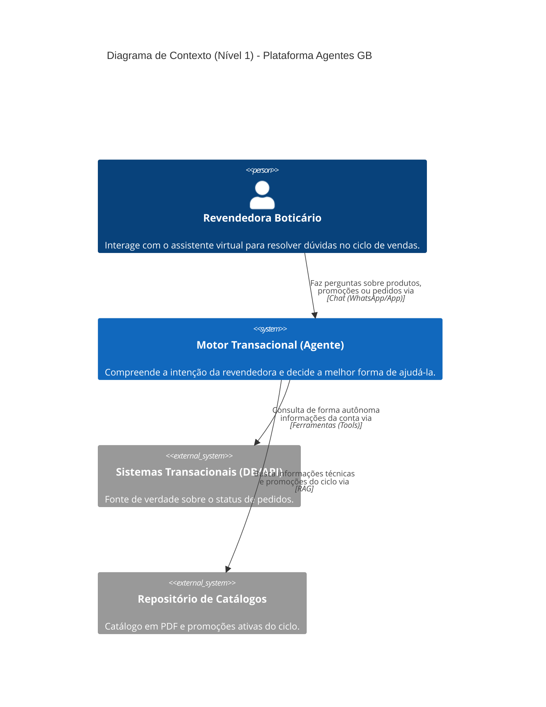

# Diagrama de Contexto (Nível 1) - Agente de Suporte à Revendedora GB

## Descrição
Este documento apresenta o Diagrama de Contexto (C4 Nível 1) do **Agente de Suporte à Revendedora do Grupo Boticário**. Ele estabelece os limites da solução, destacando os usuários finais, os sistemas corporativos externos integrados e os fluxos primários de comunicação e troca de dados.

## Visão Geral
O **Motor Transacional (Agente)** atua como um assistente virtual conversacional inteligente desenvolvido para apoiar a Revendedora Boticário durante toda a sua jornada de vendas. O agente compreende a linguagem natural da revendedora, soluciona dúvidas sobre produtos e promoções ativas do ciclo por meio de busca semântica em catálogos (RAG) e consulta dados transacionais em tempo real (status de pedidos) via ferramentas automatizadas (Tools/Function Calling), mantendo estrito isolamento de sessão e proteção rigorosa de dados pessoais (PII/LGPD).

## Diagrama

## Atores e Sistemas

| Elemento | Tipo | Descrição | Papel / Responsabilidade |
| :--- | :--- | :--- | :--- |
| **Revendedora Boticário** | Pessoa / Usuária | Parceira de vendas do Grupo Boticário. | Envia dúvidas, solicita status de pedidos, pesquisa composições e benefícios de produtos e consulta ofertas do ciclo ativo através de canais digitais (WhatsApp, App ou Portal). |
| **Motor Transacional (Agente)** | Sistema (Software) | Núcleo inteligente de orquestração com IA generativa e lógica de decisão. | Compreende a intenção da revendedora, orquestra fluxos cognitivos, aplica guardrails de segurança e privacidade (PII), invoca ferramentas transacionais e consolida respostas em streaming. |
| **Sistemas Transacionais (DB/API)** | Sistema Externo | Legado corporativo transacional de e-commerce e ERP do Grupo Boticário. | Fornece dados em tempo real sobre status e histórico de pedidos e rastreamento logístico, validados e filtrados estritamente pelo CPF vinculado à sessão. |
| **Repositório de Catálogos** | Sistema Externo | Base de conhecimento documental do ciclo de vendas (Revista / Guia de Produtos). | Armazena os catálogos em PDF e informativos comerciais do ciclo vigente, servindo de base vetorial para recuperação semântica (RAG). No MVP, o PDF do Ciclo 15 é representado por uma transcrição em Markdown (`data/catalogo_ciclo_15.md`) usada na ingestão. |

## Interações e Fluxos de Dados

1. **Atendimento à Revendedora (Canal Digital &rarr; Agente)**:
   - A revendedora envia mensagens em linguagem natural por meio da interface de chat (WhatsApp, App da Revendedora ou Web).
   - O agente processa a mensagem, identifica a intenção e orquestra a resposta utilizando Server-Sent Events (SSE) para uma experiência de baixa latência e streaming contínuo.

2. **Consulta a Catálogos e Promoções (Agente &rarr; Repositório de Catálogos via RAG)**:
   - Para dúvidas sobre produtos, lançamentos, regras de pontuação ou promoções do ciclo, o motor executa busca semântica na base vetorial de catálogos indexados.
   - Retorna trechos relevantes (chunks) com informações precisas e contextualizadas, minimizando alucinações.

3. **Operações e Consultas Transacionais (Agente &rarr; Sistemas Transacionais via Tools)**:
   - Para solicitações de status de entrega e detalhes de pedidos, o motor aciona de forma autônoma funções especializadas (*Function Calling*).
   - **Garantia de Isolamento e Segurança (PII)**: Todas as chamadas aos sistemas transacionais usam obrigatoriamente o CPF vinculado à sessão da revendedora ativa. Sem CPF de sessão, nenhuma consulta é realizada, e CPFs digitados na conversa nunca são aceitos, impossibilitando qualquer acesso cruzado a pedidos de terceiros ou exposição indevida de dados comerciais.