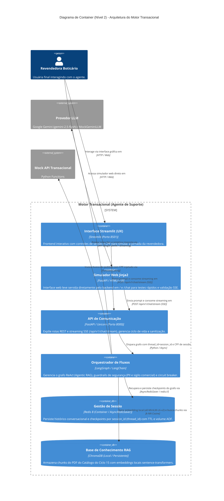

# Diagrama de Container (Nível 2) - Arquitetura do Motor Transacional

## Descrição
Este documento apresenta o Diagrama de Containers (C4 Nível 2) do **Motor Transacional (Agente de Suporte à Revendedora GB)**. Ele detalha a decomposição interna do sistema em serviços, interfaces e mecanismos de persistência de dados, evidenciando as responsabilidades técnicas de cada container, as tecnologias adotadas e a comunicação com serviços externos.

## Visão Geral
A arquitetura do motor é estruturada em torno de um orquestrador agêntico baseado em grafos de estado (**LangGraph**), exposto por uma camada de API assíncrona de alto desempenho (**FastAPI**) que entrega respostas em tempo real via **Server-Sent Events (SSE)** pelo endpoint `POST /api/v1/chat/stream`. A solução conta com duas interfaces de usuário (**Streamlit** no container dedicado e um **Simulador Web Jinja2** embutido no FastAPI), retenção de contexto conversacional com persistência em container (**Redis 8** via `AsyncRedisSaver`), busca semântica documental local (**ChromaDB** com embeddings `all-MiniLM-L6-v2`) e execução controlada de ferramentas transacionais com validação estrita de segurança e isolamento de PII.

## Diagrama

> 🔗 **Visualização alternativa:** Caso o diagrama Mermaid não carregue corretamente no GitHub, você pode visualizar a imagem estática em [docs/diagrams/c4-container.png](../diagrams/c4-container.png).

## Atores e Sistemas

| Elemento | Tipo | Tecnologia | Papel / Responsabilidade |
| :--- | :--- | :--- | :--- |
| **Revendedora Boticário** | Pessoa | Usuária Final | Interage com a interface web para tirar dúvidas sobre catálogo e consultar status de pedidos. |
| **Interface Streamlit (UX)** | Container (Frontend) | Streamlit / Python | Interface gráfica rica em container isolado (porta 8501) com formulário para alterar `session_id`, `cpf` e acompanhar respostas em streaming SSE. |
| **Simulador Web Jinja2** | Componente Web (Frontend) | HTML5 / CSS / JS (Jinja2) | Interface de demonstração embutida no FastAPI (`/` e `/chat`), permitindo testes imediatos de streaming SSE sem dependência de containers extras. |
| **API de Comunicação** | Container (Backend) | FastAPI / Uvicorn | Gateway HTTP/REST; gerencia requisições, validação de schema (Pydantic), injeção de dependências e expõe o endpoint SSE (`POST /api/v1/chat/stream`). |
| **Orquestrador de Fluxos** | Container (Agente) | LangGraph / LangChain | Conduz a máquina de estados conversacional (ReAct), aplica nós de decisão, guardrails de PII e sigilo comercial e coordena a execução de RAG e Tools com Circuit Breaker. |
| **Gestão de Sessão** | Container (Database) | Redis 8 / AsyncRedisSaver | Persiste o histórico conversacional e o estado do grafo indexados por `thread_id` / `session_id` em container com volume persistente (`redis-data`). Fallback gracioso para `MemorySaver` em ambiente de testes sem rede. |
| **Base de Conhecimento RAG** | Base Vetorial (Local) | ChromaDB / SentenceTransformers | Banco vetorial persistido localmente (`data/chromadb`). Utiliza embeddings locais gerados por `all-MiniLM-L6-v2` sobre os chunks do PDF do Catálogo do Ciclo 15 (transcrito em Markdown no MVP para ingestão). |
| **Provedor LLM** | Sistema Externo | Google Gemini (`gemini-2.5-flash`) / Mock | Modelo de linguagem responsável pela interpretação semântica, raciocínio dos agentes e síntese das respostas finais. Conta com `MockGeminiLLM` para execução offline. |
| **Mock API Transacional** | Sistema Externo | Python Functions / API Mock | Simula sistemas legados de logística e pedidos (`buscar_status_pedido`), garantindo acesso estritamente autorizado pelo CPF da sessão. |

## Interações e Fluxos de Dados

1. **Entrada do Usuário e Resposta em Streaming (UX &harr; API via REST / SSE)**:
   - A revendedora envia o prompt via interface Streamlit ou pelo Simulador Web Jinja2.
   - O backend FastAPI estabelece conexão `text/event-stream` (SSE) através de `POST /api/v1/chat/stream`, enviando tokens gerados incrementalmente no padrão `data: {"chunk": "..."}\n\n`.

2. **Orquestração de Sessão e Estados (API &harr; LangGraph &harr; Gestão de Sessão)**:
   - A API despacha a mensagem para o LangGraph informando o `session_id` como `thread_id` e o `cpf` da revendedora.
   - O Checkpointer (`AsyncRedisSaver`) carrega o estado persistido no Redis 8 correspondente à sessão, garantindo continuidade do diálogo mesmo após reinícios do serviço e isolamento total entre usuárias.

3. **Inferência Semântica e Decisão (LangGraph &harr; Provedor LLM)**:
   - O LangGraph encaminha prompts estruturados ao LLM para classificação de intenção, geração de argumentos para ferramentas ou síntese de resposta.

4. **Recuperação Documental de Catálogo (LangGraph &harr; ChromaDB via RAG)**:
   - Identificada a necessidade de dados sobre produtos ou promoções, a Tool gera o embedding da consulta localmente via SentenceTransformers (`all-MiniLM-L6-v2`) e recupera os Top-k trechos mais relevantes do catálogo ativo indexado no ChromaDB. O catálogo original em PDF é processado e preservado como fonte da verdade, com transcrição Markdown para ingestão no MVP.

5. **Execução de Ferramentas Transacionais Seguras (LangGraph &harr; Mock API via Function Calling)**:
   - Quando a intenção é consultar pedidos, o agente aciona a função parametrizada `buscar_status_pedido`.
   - **Regra de Guardrail e PII**: A consulta ao sistema transacional vincula compulsoriamente o `cpf` da sessão (`state["cpf"]`). Se a sessão não possuir CPF configurado, a Tool **não é invocada** e retorna recusa estruturada (`CPF_SESSAO_AUSENTE`). CPFs digitados livremente no chat são sumariamente ignorados para evitar vazamento de PII.