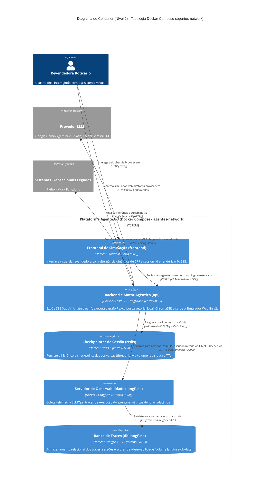

# Diagrama de Container (Nível 2) - Arquitetura e Topologia Docker Compose

## Descrição
Este documento apresenta o Diagrama de Containers (C4 Nível 2) do **Motor Transacional (Agente de Suporte à Revendedora GB)**. Ele detalha a decomposição do sistema nos **5 containers de serviço** orquestrados via `docker-compose.yml` na rede `agentes-network`, mapeando suas portas, volumes persistentes, interfaces e comunicação com modelos externos e sistemas transacionais.

## Visão Geral
A infraestrutura local é 100% containerizada em Docker Compose e composta por:
1. **Frontend (`frontend`)**: Interface web Streamlit (porta 8501) para interação conversacional com controles de sessão e CPF.
2. **Backend e Motor Cognitivo (`api`)**: Aplicação FastAPI (porta 8000) contendo as rotas SSE (`/api/v1/chat/stream`), o motor agêntico LangGraph (ReAct), a base vetorial embutida ChromaDB (`data/chromadb`) e o Simulador Web Jinja2 (`/` e `/chat`).
3. **Gestão de Sessão (`redis`)**: Container Redis 8 (porta 6379) com persistência em volume AOF (`redis-data`) para checkpointer assíncrono do LangGraph (`AsyncRedisSaver`).
4. **Servidor de Observabilidade (`langfuse`)**: Container Langfuse v2 (porta 3000) para rastreamento de chamadas ao LLM, telemetria de latência e custos.
5. **Banco de Dados de Telemetria (`db-langfuse`)**: Container PostgreSQL 15 interno com volume persistente (`langfuse-db-data`) como storage relacional do Langfuse.

## Diagrama

## Mapeamento de Containers (Docker Compose)

| Serviço (`docker-compose`) | Nome do Container | Imagem / Runtime | Portas / Volumes | Responsabilidade Técnica |
| :--- | :--- | :--- | :--- | :--- |
| **`frontend`** | `gb-support-agent-frontend` | `Dockerfile` (Python 3.11+ / Streamlit) | **Porta:** `8501:8501` **Env:** `API_URL=http://api:8000` | Interface de simulação visual da revendedora. Consome a API em streaming SSE e permite trocar `session_id` e `cpf` na barra lateral. |
| **`api`** | `gb-support-agent-api` | `Dockerfile` (Python 3.11+ / FastAPI / LangGraph) | **Porta:** `8000:8000` **Volume:** `./data:/app/data` **Env:** `REDIS_URL`, `LANGFUSE_*` | Núcleo do sistema: expõe endpoints REST/SSE (`/api/v1/chat/stream`), roda o motor LangGraph com Agentic RAG, hospeda a coleção ChromaDB local (`/app/data/chromadb`) e renderiza o Simulador Web Jinja2 (`/` e `/chat`). |
| **`redis`** | `gb-support-agent-redis` | `redis:8` | **Porta:** `6379:6379` **Volume:** `redis-data:/data` **Comando:** `--appendonly yes` | Checkpointer de persistência de estado do LangGraph. Garante isolamento por `thread_id=session_id` e preservação do contexto conversacional mesmo após reinícios de container. |
| **`langfuse`** | `gb-support-agent-langfuse` | `langfuse/langfuse:2` | **Porta:** `3000:3000` **Deps:** `db-langfuse (healthy)` | Servidor self-hosted de observabilidade LLMOps. Registra traces completos do LangGraph, latência por nó e consumo de tokens. |
| **`db-langfuse`** | `gb-support-agent-db-langfuse` | `postgres:15` | **Porta:** `5432` (interna) **Volume:** `langfuse-db-data:/var/lib/postgresql/data` | Banco relacional dedicado ao Langfuse com healthcheck nativo (`pg_isready`). |

## Redes e Volumes Docker

* **Rede Comum (`agentes-network`)**: Rede bridge dedicada garantindo resolução de DNS interno entre containers (`api`, `frontend`, `redis`, `langfuse`, `db-langfuse`).
* **Volume `redis-data`**: Persiste os dados AOF do Redis com os estados e checkpoints das sessões das revendedoras.
* **Volume `langfuse-db-data`**: Persiste dados de observabilidade, traces e telemetria do PostgreSQL do Langfuse.
* **Bind Mount `./data:/app/data`**: Mapeia o catálogo do Ciclo 15 (`catalogo_ciclo_15.md`) e o diretório de dados persistentes do ChromaDB (`data/chromadb`).

## Interações e Fluxos de Dados

1. **Jornada do Usuário e Streaming SSE (`frontend` &harr; `api`)**:
   - A revendedora envia mensagem via Streamlit (`:8501`) ou diretamente pelo Simulador Web Jinja2 (`:8000/chat`).
   - O backend FastAPI estabelece conexão `text/event-stream` através do endpoint `POST /api/v1/chat/stream`, transmitindo chunks sanitizados com valores monetários em Reais devidamente escapados (`\$`).

2. **Gestão de Sessão e Checkpointer (`api` &harr; `redis`)**:
   - A API despacha a mensagem para o LangGraph informando o `session_id` como `thread_id` e o `cpf` da revendedora.
   - O `AsyncRedisSaver` carrega o estado persistido no Redis 8 correspondente à sessão. Se o Redis estiver indisponível ou em execução local sem compose, o sistema degrada graciosamente para `MemorySaver`.

3. **Inferência Semântica e Decisão (`api` &harr; Provedor LLM)**:
   - O nó orquestrador injeta o System Prompt com os Guardrails invioláveis e aciona o modelo Gemini (ou `MockGeminiLLM` em modo offline) com `bind_tools` (`consultar_catalogo`, `buscar_status_pedido`).

4. **Recuperação Documental de Catálogo (RAG Local no `api`)**:
   - Ao decidir pela Tool `consultar_catalogo`, o motor gera embeddings locais via SentenceTransformers (`all-MiniLM-L6-v2`) e consulta a coleção persistida no ChromaDB em `/app/data/chromadb`. O PDF original é a fonte da verdade conceitual, transcrito em Markdown para a ingestão vetorial.

5. **Execução de Ferramentas Transacionais com Guardrail de PII (`api` &harr; Mock API)**:
   - Ao solicitar status de pedidos, o nó `executar_api` impõe compulsoriamente o `cpf` da sessão (`state["cpf"]`).
   - Se a sessão não contiver CPF, a Tool **não é invocada** e retorna recusa estruturada (`CPF_SESSAO_AUSENTE`). CPFs informados no chat nunca são aceitos.

6. **Telemetria e Observabilidade LLMOps (`api` &rarr; `langfuse` &rarr; `db-langfuse`)**:
   - Ao final do streaming, a API envia os traces do grafo assincronamente ao Langfuse via `CallbackHandler`.
   - **Privacidade por Design**: O CPF da revendedora é anonimizado previamente via hash HMAC-SHA256 (`src.core.security.pseudonimizar_cpf`) com sal secreto (`PII_HASH_SALT`), garantindo zero vazamento de PII na telemetria.