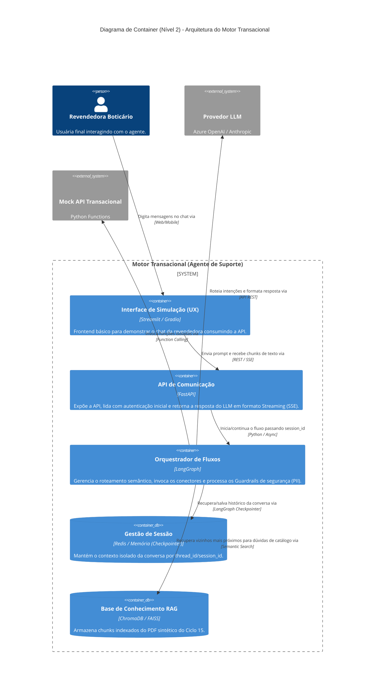

# Diagrama de Container (Nível 2) - Arquitetura do Motor Transacional

## Descrição
Este documento apresenta o Diagrama de Containers (C4 Nível 2) do **Motor Transacional (Agente de Suporte à Revendedora GB)**. Ele detalha a decomposição interna do sistema em serviços, interfaces e mecanismos de persistência de dados, evidenciando as responsabilidades técnicas de cada container, as tecnologias adotadas e a comunicação com serviços externos.

## Visão Geral
A arquitetura do motor é estruturada em torno de um orquestrador agêntico baseado em grafos de estado (**LangGraph**), exposto por uma camada de API assíncrona de alto desempenho (**FastAPI**) que entrega respostas em tempo real via **Server-Sent Events (SSE)**. A solução desacopla a interface de usuário (**Streamlit**), a retenção de contexto conversacional (**Checkpointer**), a recuperação de informações semânticas do ciclo (**ChromaDB**) e a execução controlada de ferramentas transacionais com validação estrita de segurança e isolamento de PII.

## Diagrama

## Atores e Sistemas

| Elemento | Tipo | Tecnologia | Papel / Responsabilidade |
| :--- | :--- | :--- | :--- |
| **Revendedora Boticário** | Pessoa | Usuária Final | Interage com o chat web/mobile para tirar dúvidas e consultar pedidos. |
| **Interface de Simulação (UX)** | Container (Frontend) | Streamlit / Python | Interface gráfica para interação conversacional, renderizando tokens transmitidos em tempo real via streaming. |
| **API de Comunicação** | Container (Backend) | FastAPI / Uvicorn | Gateway HTTP/REST; gerencia requisições, autenticação, injeção de dependências e expõe endpoints SSE (`text/event-stream`). |
| **Orquestrador de Fluxos** | Container (Agente) | LangGraph / LangChain | Conduz a máquina de estados conversacional, aplica nós de decisão, guardrails de PII e coordena a execução de RAG e Tools. |
| **Gestão de Sessão** | Container (Database) | Memory / Redis Checkpointer | Persiste o histórico conversacional e o estado do grafo indexados por `thread_id` / `session_id`, garantindo isolamento total de contexto entre usuárias. |
| **Base de Conhecimento RAG** | Container (Database) | ChromaDB | Banco vetorial contendo os embeddings dos catálogos (ex.: Ciclo 15) para busca por similaridade semântica (k-NN). |
| **Provedor LLM** | Sistema Externo | OpenAI / Azure / Anthropic | Modelo de linguagem responsável pela interpretação semântica, raciocínio dos agentes e síntese das respostas finais. |
| **Mock API Transacional** | Sistema Externo | Python Functions / API Mock | Simula sistemas legados transacionais (consulta de status de pedido e checagem de estoque físico) com validação de CPF. |

## Interações e Fluxos de Dados

1. **Entrada do Usuário e Resposta em Streaming (UX &harr; API via REST / SSE)**:
   - A revendedora envia o prompt via interface Streamlit.
   - O backend FastAPI estabelece conexão `text/event-stream` (SSE), enviando tokens gerados incrementalmente para visualização instantânea na tela.

2. **Orquestração de Sessão e Estados (API &harr; LangGraph &harr; Gestão de Sessão)**:
   - A API despacha a mensagem para o LangGraph informando o `session_id` e o `cpf` da revendedora.
   - O Checkpointer carrega o estado da sessão correspondente, garantindo continuidade do diálogo sem risco de cruzamento de dados com outras sessões.

3. **Inferência Semântica e Decisão (LangGraph &harr; Provedor LLM)**:
   - O LangGraph encaminha prompts estruturados ao LLM para classificação de intenção, geração de argumentos para ferramentas ou síntese de resposta.

4. **Recuperação Documental de Catálogo (LangGraph &harr; ChromaDB via RAG)**:
   - Identificada a necessidade de dados sobre produtos ou promoções, o orquestrador gera o embedding da consulta e recupera os trechos mais relevantes do catálogo ativo indexado no ChromaDB.

5. **Execução de Ferramentas Transacionais Seguras (LangGraph &harr; Mock API via Function Calling)**:
   - Quando a intenção é consultar pedidos ou estoque, o agente aciona funções parametrizadas (`buscar_status_pedido`, `consultar_estoque`).
   - **Regra de Guardrail e PII**: A consulta ao sistema transacional vincula estritamente o `cpf` autenticado da sessão. Tentativas de acessar pedidos não vinculados ao CPF da revendedora ativa são barradas e tratadas como acesso não autorizado.