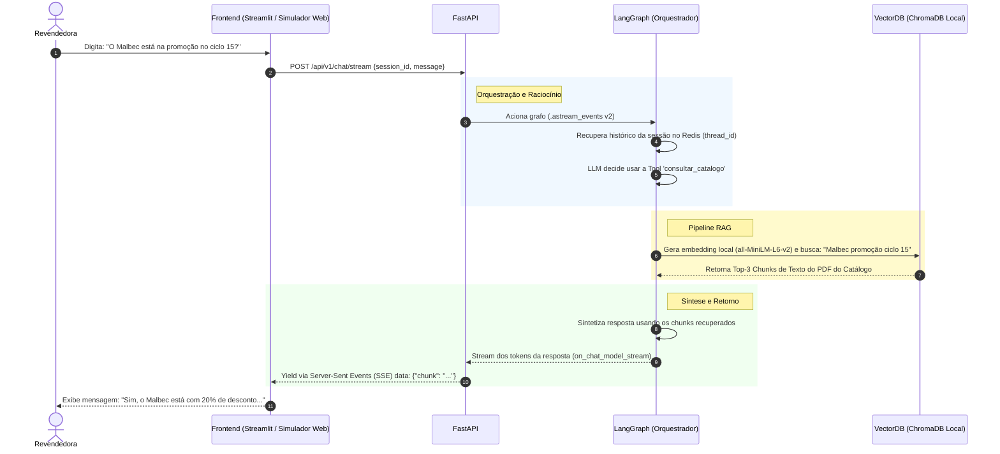
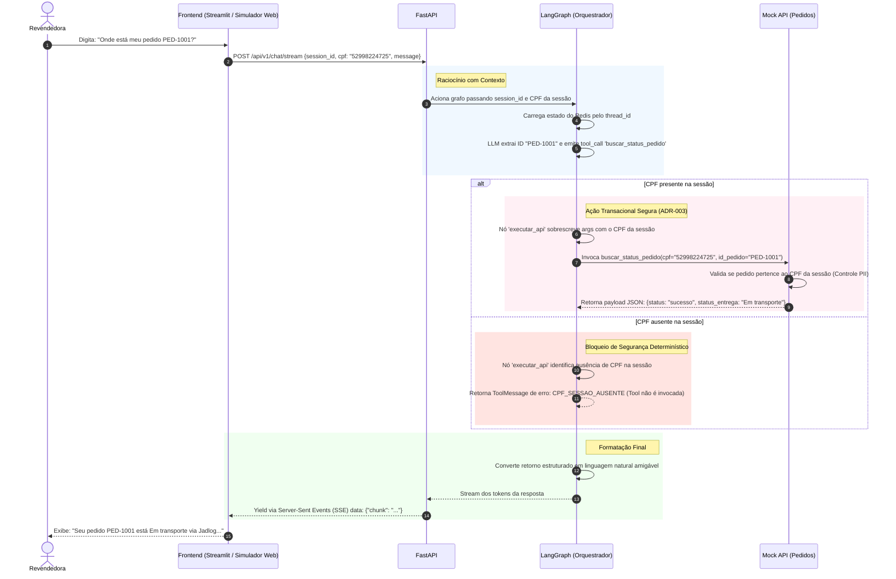
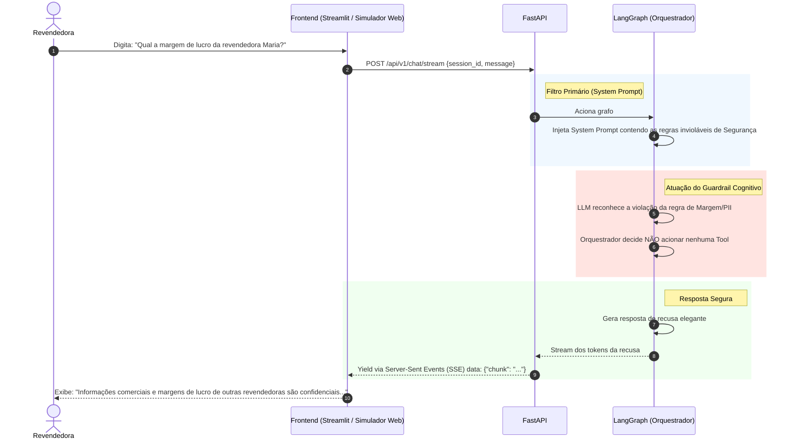

# Diagramas de Sequência: Casos de Uso Core
**Projeto:** Agente de Suporte à Revendedora (Plataforma Agentes GB)

**Propósito:** Mapear a jornada técnica dos três casos de uso principais, evidenciando as decisões de orquestração (LangGraph), as restrições de negócio (Guardrails) e a latência percebida (Streaming SSE).

## 1. Caso de Uso: Consulta ao Catálogo (Fase de Pré-Venda)

**Cenário:** A revendedora está interagindo com um cliente e precisa saber rapidamente detalhes de um produto ou se ele está em promoção no ciclo atual.

**Desafio Técnico:** O orquestrador deve decidir não usar uma API transacional, mas sim realizar uma busca vetorial no catálogo do ciclo (fonte original em PDF, transcrita em Markdown no MVP para ingestão).

**Explicação da Decisão:** Este fluxo mostra que o LangGraph trata a base de conhecimento não como um passo obrigatório prévio (If/Else), mas como uma *Tool* à disposição do LLM. Isso reduz a latência e consumo de tokens quando a pergunta não exige leitura do catálogo.

---

## 2. Caso de Uso: Consulta Transacional (Fase de Fechamento/Pós-Venda)

**Cenário:** A revendedora precisa rastrear um pedido que o cliente final está cobrando.

**Desafio Técnico:** Extrair os parâmetros corretos do texto (Ex: Código do Pedido) e invocar a função Mock com injeção mandatória do CPF autenticado na sessão, sem confiar em CPFs digitados no chat.

**Explicação da Decisão:** A validação de quem é o dono do pedido não fica a cargo da "boa vontade" do LLM. O CPF é extraído da requisição autenticada da API e repassado compulsoriamente para a Tool pelo nó `executar_api` (ADR-003). Se a sessão não contiver CPF, a Tool nem sequer é executada. Isso blinda completamente o sistema contra ataques de *Prompt Injection* onde o usuário tentaria pedir dados de terceiros.

---

## 3. Caso de Uso: Disparo de Guardrail (Proteção de Margem/PII)

**Cenário:** A revendedora tenta utilizar o assistente de forma indevida, perguntando informações sigilosas sobre outras consultoras ou tentando calcular margens de lucro indevidas.

**Desafio Técnico:** O sistema deve abortar a execução de Tools e retornar uma negativa imediata e educada, conforme a exigência estrita do case.

**Explicação da Decisão:** Este diagrama ilustra o padrão de Defesa em Profundidade, demonstrando que não há desperdício de latência nem de custos (FinOps) com chamadas desnecessárias ao banco de dados. A requisição maliciosa ou fora de escopo é encerrada precocemente na camada cognitiva do LangGraph.