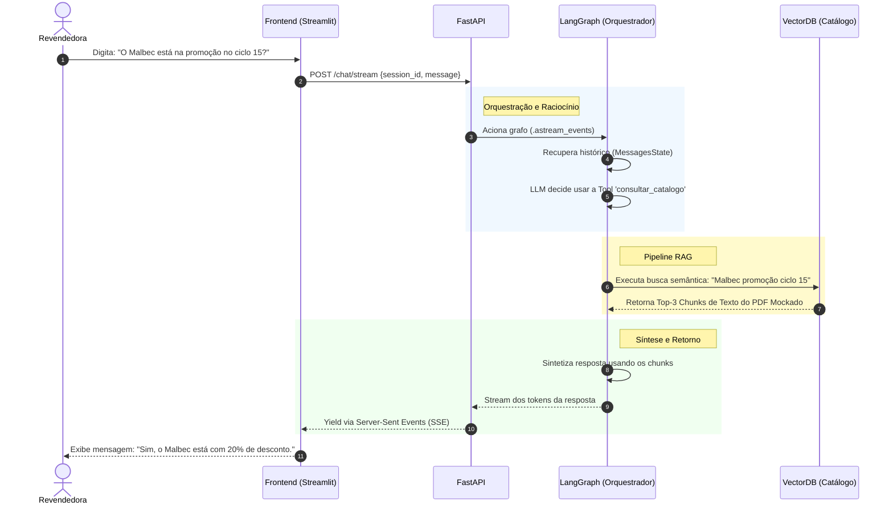
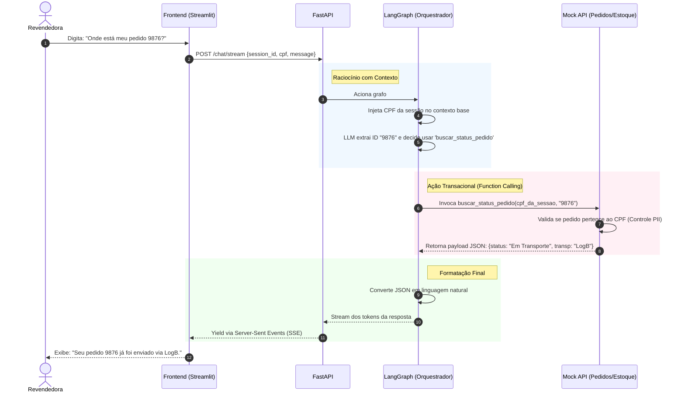
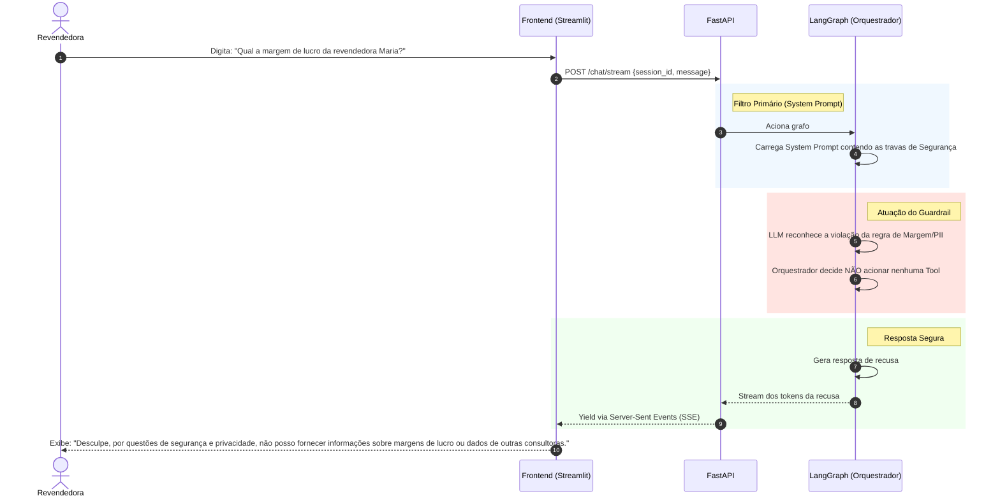

# Diagramas de Sequência: Casos de Uso Core
**Projeto:** Agente de Suporte à Revendedora (Plataforma Agentes GB)
**Propósito:** Mapear a jornada técnica dos três casos de uso principais, evidenciando as decisões de orquestração (LangGraph), as restrições de negócio (Guardrails) e a latência percebida (Streaming SSE)[cite: 1, 2].

## 1. Caso de Uso: Consulta ao Catálogo (Fase de Pré-Venda)
**Cenário:** A revendedora está interagindo com um cliente e precisa saber rapidamente detalhes de um produto ou se ele está em promoção no ciclo atual.
**Desafio Técnico:** O orquestrador deve decidir não usar uma API transacional, mas sim realizar uma busca vetorial no arquivo sintético do catálogo.

**Explicação da Decisão:** Este fluxo mostra que o LangGraph trata a base de conhecimento não como um passo obrigatório (If/Else), mas como uma *Tool* à disposição do LLM. Isso reduz a latência quando a pergunta não exige leitura do catálogo.

---

## 2. Caso de Uso: Consulta Transacional (Fase de Fechamento/Pós-Venda)
**Cenário:** A revendedora precisa consultar o estoque para fechar uma venda ou rastrear um pedido que o cliente final está cobrando.
**Desafio Técnico:** Extrair os parâmetros corretos do texto (Ex: CPF, Código do Pedido) e invocar a função Mock, garantindo que os dados pertencem à revendedora daquela sessão.

**Explicação da Decisão:** A validação de quem é o dono do pedido não fica a cargo da "boa vontade" do LLM. O CPF é extraído da requisição autenticada do FastAPI e repassado para a Tool (Passo 5 e 6). Isso blinda o sistema contra ataques de *Prompt Injection* onde o usuário tentaria pedir dados de terceiros.

---

## 3. Caso de Uso: Disparo de Guardrail (Proteção de Margem/PII)
**Cenário:** A revendedora tenta utilizar o assistente de forma indevida, perguntando informações sigilosas sobre outras consultoras ou tentando calcular margens de lucro indevidas.
**Desafio Técnico:** O sistema deve abortar a execução de Tools e retornar uma negativa imediata e educada, conforme a exigência estrita do case.

**Explicação da Decisão:** Este diagrama ilustra o padrão de Defesa em Profundidade. Mostra para os avaliadores que você não gastou latência e dinheiro (FinOps) chamando o banco de dados desnecessariamente. A requisição maliciosa ou fora de escopo morre rapidamente na camada cognitiva do LangGraph.