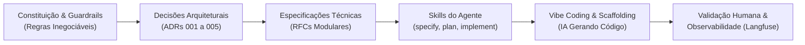

# **Relatório de Desenvolvimento: Plataforma Agentes GB**

**Projeto:** Agente de Suporte à Revendedora  
**Objetivo do Documento:** Visão geral de como o desenvolvimento foi estruturado usando IA, os principais desafios enfrentados e as lições aprendidas no processo.

## **1. Contexto e Abordagem Adotada**

Para construir a aplicação de forma rápida, mas sem perder o controle da qualidade, a estratégia de uso de IA foi dividida em duas frentes:

* **Spec-Driven Development (SDD) para o Core:** Abordagem estruturada para construir a solução principal (regras de negócio, fluxo do agente e integrações críticas). Em vez de deixar a IA gerar código livremente, o modelo foi ancorado em especificações formais, contratos de interface e regras inegociáveis. Isso garantiu que o coração da aplicação nascesse robusto.  
* **Vibe Coding para as Tarefas Auxiliares:** Para as tarefas periféricas da aplicação, adotou-se maior flexibilidade. O "Vibe Coding" foi empregado para resolver com agilidade itens como a dockerização do projeto, o setup inicial da infraestrutura e a inclusão da esteira de observabilidade com o Langfuse diretamente no Docker Compose.

Para melhor visualização, o fluxo de trabalho funcionou da seguinte forma: 

> 🔗 **Visualização alternativa:** Caso o diagrama Mermaid não carregue corretamente no GitHub, você pode visualizar a imagem estática em [docs/diagrams/vibe-coding-fluxo-desenvolvimento.png](diagrams/vibe-coding-fluxo-desenvolvimento.png).

## **2. Ferramentas Utilizadas**

O ecossistema de ferramentas foi estruturado combinando modelos especializados para ideação, implementação e revisão técnica:

* **Gemini Chat (Modelo Pro):** Utilizado para análise de requisitos de negócio, ideação, elaboração inicial dos documentos arquiteturais ([ADRs](adrs) e [Modelo C4](c4-model)) e discussões estratégicas a nível de produto. A ideia foi simular uma discussão técnica e produto e, com base nos insumos levantados, formalizar em documentos para refinamento posterior.

* **Google Antigravity IDE (Ambiente de Desenvolvimento Agentic):**
  * **Gemini 3.8 Flash:** Modelo orquestrado diretamente na IDE para implementação técnica, geração de código e boilerplate, e execução do *Spec-Driven Development (SDD)*. Dado que os requisitos iniciais do produto estavam bem mapeados e decisões arquiteturais bem definidas, a escolha de um modelo menor se mostrou eficiente, entregando velocidade e precisão, mantendo um consumo menor de tokens.
  * **Claude Opus 5.5:** Modelo de alta capacidade de raciocínio utilizado para a revisão final crítica do código-fonte, validação de segurança e refinamento da documentação técnica e a conformidade do que foi implementado com os requisitos e decisões iniciais.

## **3. Regras Inegociáveis (Guardrails)**

Para que o Spec-Driven Development funcionasse bem e a IA não gerasse um sistema inseguro, a primeira etapa foi estabelecer uma "constituição" do produto. Em vez de focar em como a IA deveria programar, o modelo foi ancorado nas regras de negócio da aplicação, que serviram como guardrails inegociáveis para a geração de código:

1. **Zero Vazamento de Dados (Segurança):** A IA foi instruída de que o código deveria garantir isolamento absoluto entre os perfis. O sistema gerado não poderia, sob nenhuma hipótese, permitir o cruzamento de dados de pedidos ou cadastros de revendedoras diferentes.
2. **Sigilo Comercial (Compliance):** O agente foi concebido e travado via código para não calcular, deduzir ou informar margens de lucro ou faturamentos, focando exclusivamente no suporte operacional da revendedora.
3. **Respostas Fluídas (UX):** Foi definido como requisito arquitetural que a aplicação deveria funcionar em streaming (SSE), garantindo a experiência de resposta em tempo real.

## **4. Onde a IA mais ajudou no dia a dia**

* **Velocidade na Infraestrutura e DevOps:** Usando a abordagem de *Vibe Coding*, a infraestrutura inicial foi gerada de forma rápida, como Dockerfiles da API e do Frontend, configuração da rede interna, plugando o banco de dados e o Langfuse no Docker Compose.  
* **Mock de Dados Sintéticos:** Para testar a aplicação de forma fidedigna, foram utilizados prompts estruturados para gerar catálogos inteiros de produtos (com descrições e preços) e históricos de pedidos realistas. Isso foi fundamental para validar o isolamento de dados entre diferentes contas.  
* **Documentação e Arquitetura:** A IA trouxe grande agilidade ao processo, auxiliando na documentação das decisões técnicas e gerando os diagramas de arquitetura (como o próprio C4 Model e ADRs).

## **5. Desafios Técnicos e Onde Foi Necessário "Colocar a Mão na Massa"**

Embora a IA tenha acelerado muito o desenvolvimento, oscilou em algumas áreas de alta complexidade que exigiram intervenção humana da equipe técnica:

* **O Desafio do Streaming (FastAPI \+ LangGraph):** A IA teve bastante dificuldade em conectar de forma assíncrona o gerador de eventos do LangGraph com o Streaming do FastAPI. O modelo tentava cuspir eventos internos de log na tela do usuário, quebrando o layout. Foi necessário intervir no código e criar um filtro manual para garantir que apenas o texto final chegasse adequadamente ao frontend.  
* **Isolamento de Sessão:** Durante a criação da máquina de estados, a IA tendia a misturar as sessões. A gestão de threads foi refatorada para garantir que a memória do agente estivesse sempre amarrada unicamente à identidade daquela revendedora específica.  
* **Alucinações e Segurança:** Constatou-se que, diante de perguntas maliciosas (ex: "quanto a revendedora X lucrou?"), a IA às vezes tentava "ajudar" inventando dados. A solução adotada foi categórica: essa responsabilidade foi retirada do prompt e a segurança foi blindada **diretamente no código Python**, criando validações que barram a consulta no banco de dados se o CPF não for compatível, antes mesmo de a informação chegar à IA.

## **7. Lições Aprendidas**

1. **Para lógica de negócio, a IA precisa de trilhos:** O *Vibe Coding* é vantajoso para infraestrutura e configurações auxiliares. Mas tentar fazer lógica de negócio sem especificação (SDD) gera inconsistências e retrabalho.  
2. **Código assíncrono moderno ainda confunde a IA:** Ferramentas muito recentes (como LangGraph) ainda têm particularidades que a IA não domina totalmente. A revisão humana profunda na camada de comunicação (I/O e rede) é obrigatória.  
3. **Segurança de verdade se faz no código, não no prompt:** Engenharia de prompt ajuda a guiar o tom do agente, mas blindar vazamento de dados de verdade exige regras estritas programadas no código-fonte das ferramentas.  
4. **Observabilidade desde o dia zero salva vidas:** A integração do Langfuse desde o início (facilitada pelo Vibe Coding no Docker) poupou dezenas de horas de depuração. Era possível visualizar com exatidão onde o agente apresentava lentidão ou quais ferramentas eram acionadas internamente.