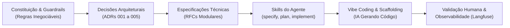

# **Relatório de Desenvolvimento: Plataforma Agentes GB**

**Projeto:** Agente de Suporte à Revendedora  
**Objetivo do Documento:** Visão geral de como estruturamos o desenvolvimento usando IA, os principais desafios que enfrentamos e as lições que tiramos do processo.

## **1. Contexto e Nossa Abordagem**

Para construir a aplicação de forma rápida, mas sem perder o controle da qualidade, dividimos nossa estratégia de uso de IA em duas frentes bem claras:

* **Spec-Driven Development (SDD) para o Core:** Usamos essa abordagem estruturada para construir a solução principal (regras de negócio, fluxo do agente e integrações críticas). Em vez de deixar a IA gerar código livremente, nós ancoramos o modelo em especificações formais, contratos de interface e regras inegociáveis. Isso garantiu que o coração da aplicação nascesse robusto.  
* **Vibe Coding para as Tarefas Auxiliares:** Já para o que ficava em torno da aplicação, soltamos as amarras. Usamos o "Vibe Coding" (geração mais fluida e interativa com a IA) para resolver rápido coisas como a dockerização do projeto, o setup inicial da infraestrutura e a inclusão da esteira de observabilidade com o Langfuse direto no Docker Compose.

Para visualizar melhor, nosso fluxo de trabalho funcionou assim:

## **2. Ferramentas Utilizadas**

Estruturamos nosso ecossistema de ferramentas combinando modelos especializados para ideação, implementação e revisão técnica:

* **Gemini Chat (Modelo Pro):** Utilizado para análise de requisitos de negócio, ideação, elaboração inicial dos documentos arquiteturais ([ADRs](adrs) e [Modelo C4](c4-model)) e discussões estratégicas a nível de produto.
* **Google Antigravity IDE (Ambiente de Desenvolvimento Agentic):**
  * **Gemini 3.8 Flash:** Modelo orquestrado diretamente na IDE para implementação técnica, geração de código e boilerplate, e execução do *Spec-Driven Development (SDD)* guiado por skills.
  * **Claude Opus 5.5:** Modelo de alta capacidade de raciocínio utilizado para a revisão final crítica do código-fonte, validação de segurança e refinamento da documentação técnica.

## **3. Nossas Regras Inegociáveis (Guardrails)**

Para que o Spec-Driven Development funcionasse bem e a IA não gerasse um sistema inseguro, a primeira etapa foi estabelecer uma "constituição" do produto. Em vez de focarmos em como a IA deveria programar, nós a ancoramos nas regras de negócio da aplicação, que serviram como guardrails inegociáveis para a geração de código:

1. **Zero Vazamento de Dados (Segurança):** Instruímos a IA de que o código deveria garantir isolamento absoluto entre os perfis. O sistema gerado não poderia, sob nenhuma hipótese, permitir o cruzamento de dados de pedidos ou cadastros de revendedoras diferentes.
2. **Sigilo Comercial (Compliance):** O agente foi concebido e travado via código para não calcular, deduzir ou informar margens de lucro ou faturamentos, focando exclusivamente no suporte operacional da revendedora.
3. **Respostas Fluídas (UX):** Colocamos como requisito arquitetural que a aplicação deveria funcionar em streaming (SSE), garantindo a experiência de resposta em tempo real.

## **4. Onde a IA mais ajudou no dia a dia**

* **Velocidade na Infraestrutura e DevOps:** Usando a abordagem de *Vibe Coding*, a ideia foi gerar a infraestrutura inicial de forma rápida, como Dockerfiles da API e do Frontend, configuração da rede interna, plugando o banco de dados e o Langfuse no Docker Compose.  
* **Mock de Dados Sintéticos:** Para testar a aplicação de forma fidedigna, usamos prompts estruturados para gerar catálogos inteiros de produtos (com descrições e preços) e históricos de pedidos realistas. Isso foi fundamental para validar o isolamento de dados entre diferentes contas.  
* **Documentação e Arquitetura:** A IA adiantou muito o nosso lado ajudando a documentar nossas decisões técnicas e gerando os diagramas de arquitetura (como o próprio C4 Model e ADRs).

## **5. Desafios Técnicos e Onde Tivemos que "Colocar a Mão na Massa"**

Embora a IA tenha acelerado muito o desenvolvimento, ela patinou em algumas áreas de alta complexidade que exigiram a intervenção humana da nossa equipe técnica:

* **O Desafio do Streaming (FastAPI \+ LangGraph):** A IA teve bastante dificuldade em conectar de forma assíncrona o gerador de eventos do LangGraph com o Streaming do FastAPI. O modelo tentava cuspir eventos internos de log na tela do usuário, quebrando o layout. Tivemos que intervir no código e criar um filtro manual para garantir que apenas o texto final chegasse certinho no frontend.  
* **Isolamento de Sessão:** Durante a criação da máquina de estados, a IA tendia a misturar as sessões. Refatoramos a gestão de threads para garantir que a memória do agente estivesse sempre amarrada unicamente à identidade daquela revendedora específica.  
* **Alucinações e Segurança:** Percebemos que, diante de perguntas maliciosas (ex: "quanto a revendedora X lucrou?"), a IA às vezes tentava "ajudar" inventando dados. A nossa solução foi categórica: tiramos essa responsabilidade do prompt e travamos a segurança **direto no código Python**. Criamos validações que barram a consulta no banco de dados se o CPF não bater, antes mesmo de a informação chegar na IA.

## **6. Impacto na Produtividade**

O saldo da nossa abordagem híbrida (SDD \+ Vibe Coding) foi extremamente positivo. Nas tarefas de configuração, infraestrutura (Docker) e documentação inicial, sentimos um ganho de tempo na casa dos **75% a 85%**. Já no desenvolvimento da lógica de negócio complexa — onde precisamos revisar mais e ajustar regras —, a redução de tempo foi de cerca de **55%**. No geral, entregamos o escopo em uma fração do tempo que levaríamos no modelo tradicional.

## **7. Lições Aprendidas**

1. **Para lógica de negócio, a IA precisa de trilhos:** O *Vibe Coding* é maravilhoso para infraestrutura e configurações auxiliares. Mas tentar fazer lógica de negócio sem especificação (SDD) só gera gambiarras e muito retrabalho.  
2. **Código assíncrono moderno ainda confunde a IA:** Ferramentas muito recentes (como LangGraph) ainda têm particularidades que a IA não domina totalmente. A revisão humana profunda na camada de comunicação (I/O e rede) é obrigatória.  
3. **Segurança de verdade se faz no código, não no prompt:** Engenharia de prompt ajuda a guiar o tom do agente, mas blindar vazamento de dados de verdade exige regras estritas programadas no código-fonte das ferramentas.  
4. **Observabilidade desde o dia zero salva vidas:** Ter integrado o Langfuse desde o início (facilitado pelo nosso Vibe Coding no Docker) nos poupou dezenas de horas de debug. Conseguíamos ver exatamente onde o agente estava travando ou quais ferramentas ele acionava por debaixo dos panos.