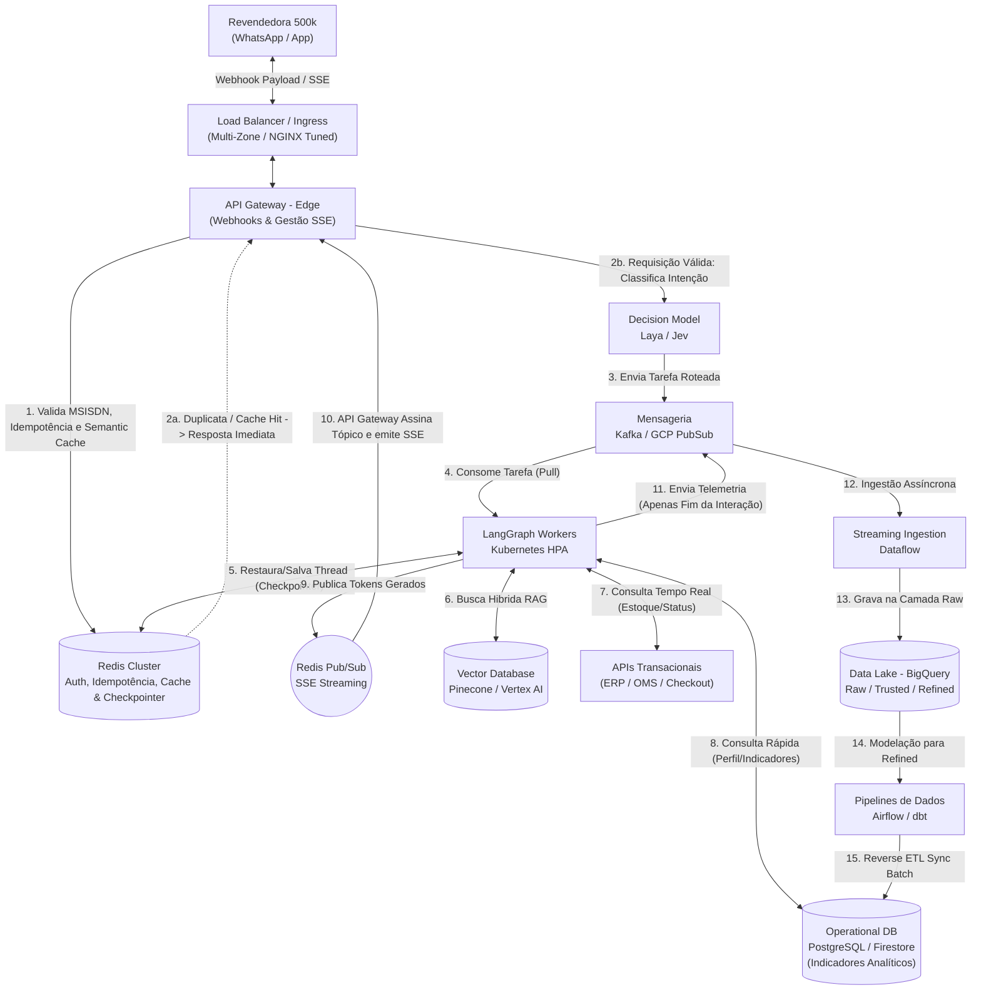
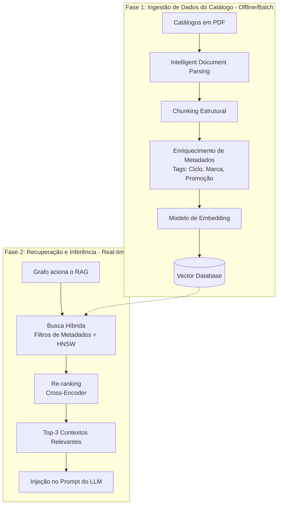
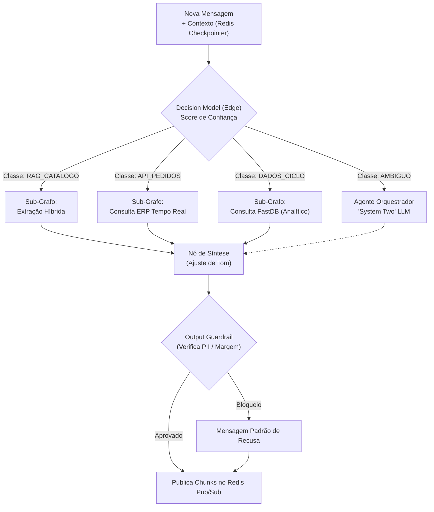

# System Design: Evolução para 500k Conexões e Data Lake

**Projeto:** Agente de Suporte à Revendedora (Plataforma Agentes GB)

**Ficheiro:** `docs/system-design-500k.md`

**Propósito:** Mapear a arquitetura TO-BE e as estratégias operacionais para suportar o crescimento até 500.000 revendedoras em simultâneo, garantindo resiliência, otimização de custos (FinOps) e integração bidirecional inteligente com o Data Lake (BigQuery).

## 1. Visão Executiva (Event-Driven, FinOps & Data Lake)
A transição do MVP para a escala de 500 mil acessos exige o abandono de uma arquitetura estritamente síncrona. O gargalo principal num sistema de agentes generativos com Streaming SSE é a retenção prolongada de conexões de rede enquanto se aguarda o raciocínio do modelo. 

A arquitetura alvo (TO-BE) baseia-se no **desacoplamento via mensageria (Event-Driven)**, onde a gestão da conectividade da revendedora é separada fisicamente do processamento pesado do LangGraph. Adicionalmente, introduz-se uma estratégia híbrida de dados: integrações de tempo real para dados transacionais (estoque/pedidos) e uma camada de *Reverse ETL* para consumo de indicadores analíticos em baixa latência, combinadas com regras de FinOps e *Semantic Routing* para mitigar custos com o LLM.

### 1.1. Requisitos Arquiteturais
Para balizar as decisões de design, a arquitetura obedece aos seguintes requisitos core:

*   **Requisitos Funcionais:**
    *   Compreender intenções e rotear dinamicamente entre RAG (catálogos) e Tools/APIs (pedidos).
    *   Manter histórico de contexto longo e isolado por sessão/revendedora.
    *   Consultar bases transacionais e analíticas para apoiar o ciclo de vendas.
*   **Requisitos Não Funcionais:**
    *   **Escalabilidade:** Suportar picos de até 500.000 conexões simultâneas (WhatsApp/App).
    *   **Latência:** Time-to-First-Token (TTFT) inferior a 2 segundos (p95).
    *   **Segurança e Conformidade:** Bloqueio estrito de vazamento de PII (LGPD) e dados sensíveis (margens de lucro de terceiros).

## 2. Diagrama Arquitetural TO-BE (Cloud Architecture)

> 🔗 **Visualização alternativa:** Caso o diagrama Mermaid não carregue corretamente no GitHub, você pode visualizar a imagem estática em [docs/diagrams/system-design-cloud-architecture.png](diagrams/system-design-cloud-architecture.png).

## 3. AI Data Engineering (A Esteira do RAG)
Para garantir respostas precisas sobre os catálogos promocionais sem estourar o limite de tokens ou aumentar a latência, a arquitetura implementa um pipeline robusto de preparação de dados.

> 🔗 **Visualização alternativa:** Caso o diagrama Mermaid não carregue corretamente no GitHub, você pode visualizar a imagem estática em [docs/diagrams/system-design-esteira-rag.png](diagrams/system-design-esteira-rag.png).

## 4. Matriz de Evolução (De/Para)

| Domínio Arquitetural | AS-IS (Cenário MVP) | TO-BE (Escala de 500.000 Revendedoras) | Justificativa de Negócio / Técnica |
| :--- | :--- | :--- | :--- |
| **Ponto de Entrada (API)** | FastAPI Monolítico (roteamento + processamento LangGraph). | **Edge Gateway (Envoy/NGINX) + FastAPI SSE Edge**. Focado exclusivamente em gerenciar conexões via subscrição Redis Pub/Sub. | 500k conexões SSE derrubariam um Worker padrão. O offload de rede previne a exaustão HTTP. |
| **Processamento (Motor)** | Síncrono no `app_graph.astream_events()`. | **LangGraph Workers** isolados no Kubernetes, consumindo fila do Kafka/PubSub e escalando via HPA. | Permite escalar a inferência de IA independentemente do tráfego de rede da borda. |
| **Base de Conhecimento** | ChromaDB (Local / Em memória). | **Pinecone / Vertex AI Search** com indexação HNSW e Busca Híbrida. | Evita estouros de memória e garante latência sub-segundo. |
| **Acesso a Dados (Tools)** | Mock/API Síncrona. | **Híbrido: APIs de ERP (Tempo Real) + FastDB via Reverse ETL (Analítico).** | Garante que o estoque seja exato (sem defasagem) enquanto indicadores do ciclo vêm de um banco de leitura otimizado e separado do BigQuery (OLAP). |
| **Memória de Sessão** | Variáveis em memória ou DB SQL padrão. | **LangGraph Checkpointer apontado para o Redis Cluster.** | Permite que qualquer Worker retome o contexto exato da revendedora (Thread ID), essencial em sistemas distribuídos. |
| **Segurança e Guardrails** | Prompting simples (System Prompt). | **Output Guardrails (LlamaGuard/NeMo)** processando a saída antes do envio SSE. | Garante conformidade de nível enterprise, impedindo o vazamento de PII e Margens de Lucro mesmo se houver alucinação do LLM. |
| **Telemetria / Observabilidade** | Logs transacionais granulares em tempo real. | **Envio em Batch/Pós-interação via PubSub -> Dataflow -> BigQuery.** | Enviar tokens individuais por streaming para telemetria onera a infraestrutura. Os logs são agregados na conclusão do grafo. |

## 5. Mecanismos de Defesa e Otimização (FinOps)

1. **Semantic Caching:** Respostas a perguntas repetitivas são cacheadas vetorialmente no Redis. Se outra revendedora perguntar algo semanticamente similar, o Gateway devolve a cache, poupando 100% da inferência.
2. **Model Cascading (Roteamento Semântico):** Um classificador ultraleve atua na borda antes de invocar o LLM Orquestrador. Modelos de maior custo são reservados apenas para orquestrações ambíguas ou complexas.
3. **Circuit Breakers para APIs Transacionais:** Chamadas ao ERP (estoque/pedidos) possuem Circuit Breakers. Em caso de indisponibilidade, o agente devolve uma mensagem padrão, evitando o colapso dos LangGraph Workers.
4. **Provisioned Throughput:** Substituição do modelo *Pay-as-you-go* por capacidade reservada ou clusters vLLM próprios (GCP GKE) para evitar gargalos em limites de tokens/minuto da provedora de IA.

## 6. Orquestração do Agente (Decision Models & Sub-grafos)

Para suportar 500k conexões, abandona-se o loop autônomo ReAct puro (que consome muitos tokens e idas e vindas) em favor de uma **Arquitetura de Sub-grafos Roteada**. Modelos de decisão estruturada (como Laya ou Jev) avaliam o estado inicial e acionam apenas o fluxo estritamente necessário.

> 🔗 **Visualização alternativa:** Caso o diagrama Mermaid não carregue corretamente no GitHub, você pode visualizar a imagem estática em [docs/diagrams/system-design-orquestracao-subgrafos.png](diagrams/system-design-orquestracao-subgrafos.png).

## 7. Considerações Arquiteturais e Resiliência

Para operar em território nacional via WhatsApp, a arquitetura incorpora padrões de resiliência e segurança de nível enterprise:

1. **Autenticação e Identidade (WhatsApp):** O número de telefone (MSISDN) atua como identidade primária. O API Gateway/Webhook realiza um lookup em cache (Redis) do MSISDN contra a base de revendedoras ativas. Após validação, a sessão é atrelada a um `thread_id` seguro no LangGraph, garantindo isolamento total de contexto e impedindo acesso cruzado a dados de terceiros.

2. **Idempotência (Proteção contra Retries):** Redes móveis oscilantes forçam o WhatsApp a reenviar webhooks se não receberem um HTTP 200 rápido. O sistema utiliza o ID único da mensagem como chave de idempotência no Redis. O *Router* verifica essa chave antes de publicar no *Broker*; duplicatas são descartadas silenciosamente, evitando processamento repetido e queima desnecessária de tokens LLM.

3. **Disponibilidade e SLAs:** Para suportar a escala do Brasil inteiro, os clusters Kubernetes (HPA), Kafka e Redis são distribuídos em múltiplas zonas de disponibilidade (Multi-Zone Deployments). Aplica-se o padrão de *Graceful Degradation*: caso o Vector DB (Pinecone) fique temporariamente indisponível, o agente responde de forma amigável sobre a indisponibilidade, sem expor erros técnicos à revendedora.

4. **Trade-offs Arquiteturais:**
    * **Complexidade vs. Escala:** A transição de um FastAPI síncrono para *Workers* desacoplados consumindo Kafka permite a escala para 500k acessos, mas introduz complexidade operacional (monitoramento de lag de fila, tracing distribuído e gestão de falhas assíncronas).
    * **Custo vs. Frescor de Dados:** Consultar o ERP em tempo real para status de pedidos garante máxima precisão, mas pode sobrecarregar sistemas legados. O trade-off adotado foi separar a leitura: dados analíticos (indicadores do ciclo) são servidos por um banco rápido (FastDB) alimentado via *Reverse ETL*, poupando o ERP e reduzindo latência.

## 8. Premissas e Limites de Escopo (Assumptions)

Para manter o foco do design arquitetural nos componentes core de orquestração de IA e mensageria distribuída, algumas capacidades enterprise foram abstraídas sob a premissa de que a corporação já as possui nativamente em seu ecossistema centralizado e mantido por times de Plataforma:

1. **AI Gateway & Model Router:** Não se detalhou a inclusão de um AI Gateway (ex: LiteLLM, Kong AI) para fazer o roteamento e gerenciamento de modelos. Assume-se que a Plataforma de Agentes da empresa já provê essa infraestrutura para gerenciar chaves, *fallbacks*, versionamento e load balancing entre os provedores de LLM.
2. **Controle de Token Budget & Rate Limiting:** A gestão financeira granular de cota por squad (Token Budgeting) e as estratégias de *rate limit* (ex: algoritmos de *Leaky Bucket* ou *Token Bucket* para inferência) não foram modeladas diretamente nesta arquitetura de aplicação, assumindo-se que essas regras de governança e *throttling* já são aplicadas no perímetro do AI Gateway corporativo existente.