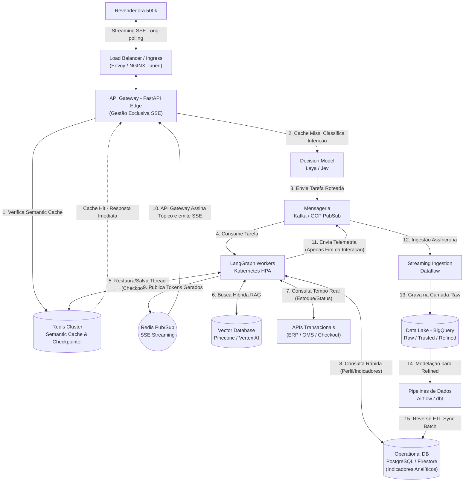
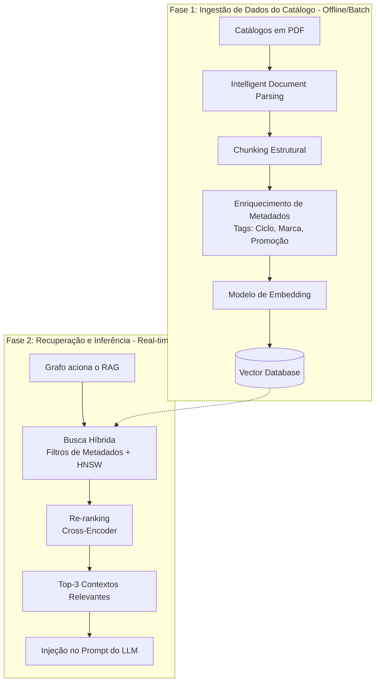
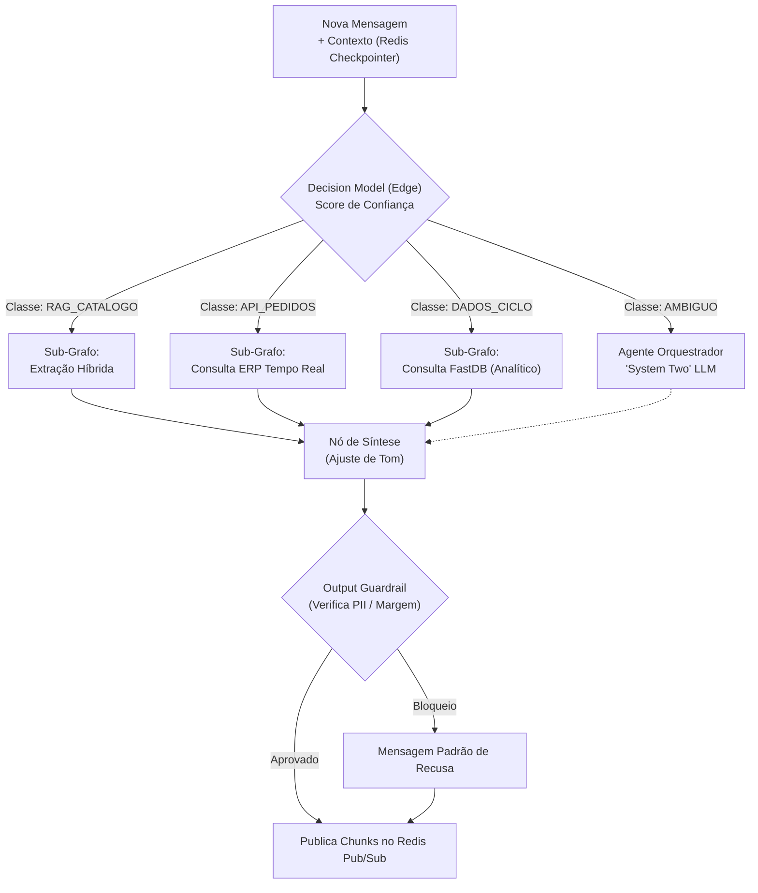

# System Design: Evolução para 500k Conexões e Data Lake

**Projeto:** Agente de Suporte à Revendedora (Plataforma Agentes GB)

**Ficheiro:** `docs/system-design-500k.md`

**Propósito:** Mapear a arquitetura TO-BE e as estratégias operacionais para suportar o crescimento até 500.000 revendedoras em simultâneo, garantindo resiliência, otimização de custos (FinOps) e integração bidirecional inteligente com o Data Lake (BigQuery).

## 1. Visão Executiva (Event-Driven, FinOps & Data Lake)
A transição do MVP para a escala de 500 mil acessos exige o abandono de uma arquitetura estritamente síncrona. O gargalo principal num sistema de agentes generativos com Streaming SSE é a retenção prolongada de conexões de rede enquanto se aguarda o raciocínio do modelo. 

A arquitetura alvo (TO-BE) baseia-se no **desacoplamento via mensageria (Event-Driven)**, onde a gestão da conectividade da revendedora é separada fisicamente do processamento pesado do LangGraph. Adicionalmente, introduz-se uma estratégia híbrida de dados: integrações de tempo real para dados transacionais (estoque/pedidos) e uma camada de *Reverse ETL* para consumo de indicadores analíticos em baixa latência, combinadas com regras de FinOps e *Semantic Routing* para mitigar custos com o LLM.

## 2. Diagrama Arquitetural TO-BE (Cloud Architecture)

## 3. AI Data Engineering (A Esteira do RAG)
Para garantir respostas precisas sobre os catálogos promocionais sem estourar o limite de tokens ou aumentar a latência, a arquitetura implementa um pipeline robusto de preparação de dados.

## 4. Matriz de Evolução (De/Para)

| Domínio Arquitetural | AS-IS (Cenário MVP) | TO-BE (Escala de 500.000 Revendedoras) | Justificativa de Negócio / Técnica |
| :--- | :--- | :--- | :--- |
| **Ponto de Entrada (API)** | FastAPI Monolítico (roteamento + processamento LangGraph). | **Edge Gateway (Envoy/NGINX) + FastAPI SSE Edge**. Focado exclusivamente em gerenciar conexões via subscrição Redis Pub/Sub. | 500k conexões SSE derrubariam um Worker padrão. O offload de rede previne a exaustão HTTP. |
| **Processamento (Motor)** | Síncrono no `app_graph.astream_events()`. | **LangGraph Workers** isolados no Kubernetes, consumindo fila do Kafka/PubSub e escalando via HPA. | Permite escalar a inferência de IA independentemente do tráfego de rede da borda. |
| **Base de Conhecimento** | ChromaDB (Local / Em memória). | **Pinecone / Vertex AI Search** com indexação HNSW e Busca Híbrida. | Evita estouros de memória e garante latência sub-segundo. |
| **Acesso a Dados (Tools)** | Mock/API Síncrona. | **Híbrido: APIs de ERP (Tempo Real) + FastDB via Reverse ETL (Analítico).** | Garante que o estoque seja exato (sem defasagem) enquanto indicadores do ciclo vêm de um banco de leitura otimizado e separado do BigQuery (OLAP). |
| **Memória de Sessão** | Variáveis em memória ou DB SQL padrão. | **LangGraph Checkpointer apontado para o Redis Cluster.** | Permite que qualquer Worker retome o contexto exato da revendedora (Thread ID), essencial em sistemas distribuídos. |
| **Segurança e Guardrails** | Prompting simples (System Prompt). | **Output Guardrails (LlamaGuard/NeMo)** processando a saída antes do envio SSE. | Garante conformidade de nível enterprise, impedindo o vazamento de PII e Margens de Lucro mesmo se houver alucinação do LLM. |
| **Telemetria / Observabilidade** | Logs transacionais granulares em tempo real. | **Envio em Batch/Pós-interação via PubSub -> Dataflow -> BigQuery.** | Enviar tokens individuais por streaming para telemetria onera infraestrutura. Agregamos os logs na conclusão do grafo. |

## 5. Mecanismos de Defesa e Otimização (FinOps)

1. **Semantic Caching:** Respostas a perguntas repetitivas são cacheadas vetorialmente no Redis. Se outra revendedora perguntar algo semanticamente similar, o Gateway devolve a cache, poupando 100% da inferência.
2. **Model Cascading (Roteamento Semântico):** Um classificador ultraleve atua na borda antes de invocar o LLM Orquestrador. Reservamos modelos caros apenas para orquestrações ambíguas ou complexas.
3. **Circuit Breakers para APIs Transacionais:** Chamadas ao ERP (estoque/pedidos) possuem Circuit Breakers. Em caso de indisponibilidade, o agente devolve uma mensagem padrão, evitando o colapso dos LangGraph Workers.
4. **Provisioned Throughput:** Substituição do modelo *Pay-as-you-go* por capacidade reservada ou clusters vLLM próprios (GCP GKE) para evitar gargalos em limites de tokens/minuto da provedora de IA.

## 6. Orquestração do Agente (Decision Models & Sub-grafos)

Para suportar 500k conexões, abandonamos o loop autônomo ReAct puro (que consome muitos tokens e idas/vindas) em favor de uma **Arquitetura de Sub-grafos Roteada**. Modelos de decisão estruturada (como Laya ou Jev) avaliam o estado inicial e acionam apenas o fluxo estritamente necessário.

---

## 7. Relatório de Desenvolvimento Assistido por IA (Vibe Coding)

*(Esta seção detalha a estratégia de uso de IA generativa durante a construção deste case, conforme exigência do desafio).*

### Ferramentas Utilizadas
* **IDE / Assistente:** [Ex: Cursor AI / GitHub Copilot]
* **Modelos Utilizados:** [Ex: Claude 3.5 Sonnet para arquitetura e refatoração complexa, GPT-4o para geração de dados mockados]
* **Ferramentas Auxiliares:** [Ex: ChatGPT para revisão de diagramas Mermaid, Perplexity para pesquisa de documentação atualizada do LangGraph]

### Estruturação dos Prompts Iniciais
1. **Modelagem de Dados e Mocks:** Utilizei prompts para gerar a base sintética do RAG garantindo a diversidade das entidades. *Exemplo de prompt: "Gere um mock de catálogo em Markdown simulando produtos Boticário e Eudora do Ciclo 15, contendo sku, nome, descrição olfativa e preço promocional."*
2. **Setup do Grafo (LangGraph):** Pedi à IA para desenhar o esqueleto do StateGraph com foco em tipagem estática (Pydantic). *Exemplo: "Crie um StateGraph usando LangGraph e FastAPI. O estado deve conter mensagens, flag de intenção e um checkpointer. Foque apenas no scaffolding."*

### Desafios e Correções (Obstáculos da IA)
* **Obstáculo Principal:** A IA frequentemente falha ao implementar o Streaming (SSE) nativo de eventos assíncronos do LangGraph (`astream_events`) direto para o FastAPI, muitas vezes sugerindo retornos síncronos que quebram o gerador, ou se perdendo na gestão das *threads* da memória.
* **A Solução Adotada:** Tive que intervir manualmente no código gerado para ajustar o retorno do endpoint, garantindo que o `StreamingResponse` do FastAPI consumisse corretamente o iterador assíncrono do LangGraph sem fechar a conexão prematuramente. Além disso, corrigi a implementação do `AsyncSqliteSaver` (ou RedisSaver) para assegurar que a thread ID da revendedora estivesse sendo passada corretamente em cada invocação da run.