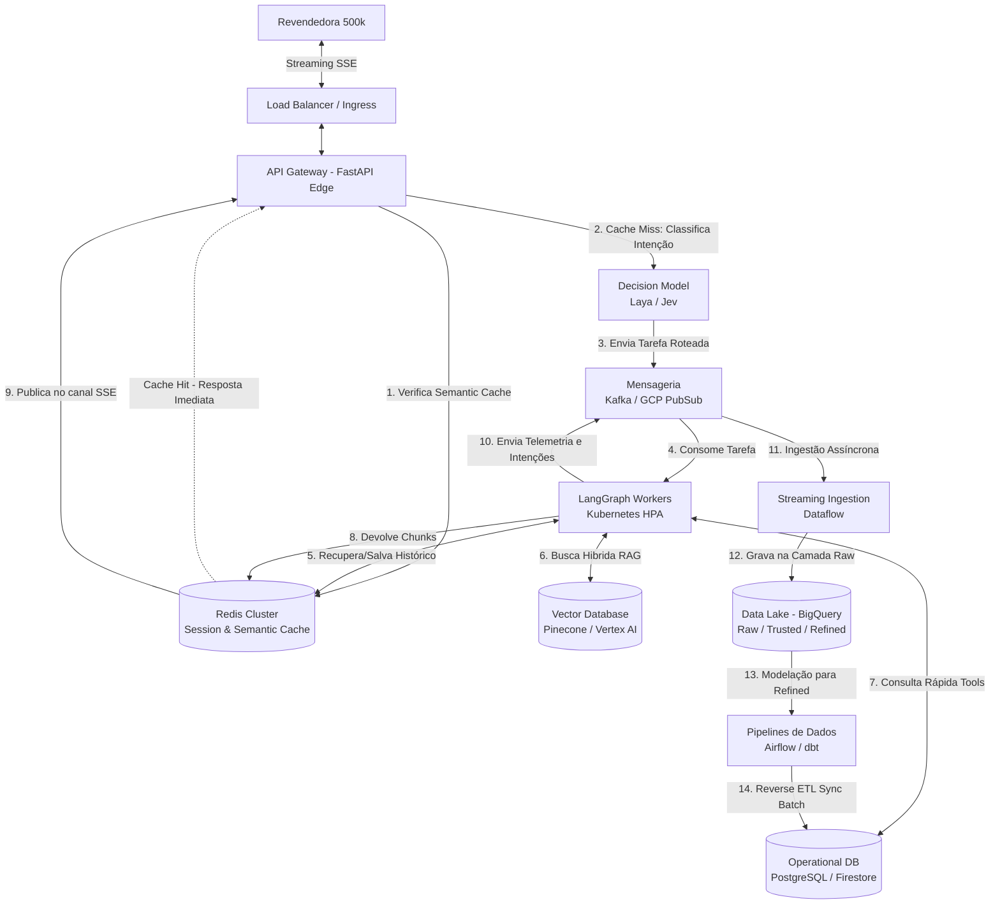

# System Design: Evolução para 500k Conexões e Data Lake

**Projeto:** Agente de Suporte à Revendedora (Plataforma Agentes GB)

**Ficheiro:** `docs/system-design-500k.md`

**Propósito:** Mapear a arquitetura TO-BE e as estratégias operacionais para suportar o crescimento até 500.000 revendedoras em simultâneo, garantindo resiliência, otimização de custos (FinOps) e integração bidirecional inteligente com o Data Lake (BigQuery).

## 1. Visão Executiva (Event-Driven, FinOps & Data Lake)
A transição do MVP para a escala de 500 mil acessos exige o abandono de uma arquitetura estritamente síncrona. O gargalo principal num sistema de agentes generativos com Streaming SSE é a retenção prolongada de conexões de rede enquanto se aguarda o raciocínio do modelo. 

A arquitetura alvo (TO-BE) baseia-se no **desacoplamento via mensageria (Event-Driven)**, onde a gestão da conectividade da revendedora é separada fisicamente do processamento pesado do LangGraph. Adicionalmente, introduz-se uma camada de *Reverse ETL* para consumo de dados analíticos em tempo real e regras de FinOps com *Semantic Routing* para mitigar custos com o LLM principal.

## 2. Diagrama Arquitetural TO-BE (Cloud Architecture)



## 3. AI Data Engineering (A Esteira do RAG)
Para garantir respostas precisas sobre os catálogos promocionais (ex: "Catálogo do Ciclo 15") sem estourar o limite de tokens ou aumentar a latência, a arquitetura implementa um pipeline robusto de preparação de dados antes da fase de inferência:

* **Intelligent Document Parsing:** Utilização de analisadores visuais multimodais (ex: LlamaParse, Document AI) em vez de extratores de texto simples. Isso garante que a relação espacial entre imagens, tabelas de volumetria e preços seja preservada.
* **Chunking Semântico e Estrutural:** A quebra de texto ocorre por "unidade de produto" ou página estruturada, e não por limites fixos de caracteres. Isso evita que o LLM misture as características de produtos distintos.
* **Enriquecimento com Metadados:** Cada bloco de texto (chunk) extraído recebe tags rígidas antes de ser vetorizado (ex: `{"ciclo": "15", "marca": "Eudora", "categoria": "Perfumaria", "em_promocao": true}`).
* **Busca Híbrida com Metadata Filtering:** Quando o LangGraph identifica a intenção da revendedora, ele aplica filtros SQL-like diretos no banco vetorial (`WHERE marca='Eudora' AND em_promocao=true`). Isso restringe a busca de milhares de vetores para uma fração mínima, aplicando a similaridade semântica (HNSW) de forma otimizada.
* **Re-ranking (Cross-Encoder):** Os resultados iniciais do Vector DB passam por um modelo de re-rank (ex: Cohere Rerank), que os reordena com alta precisão. Apenas os top-3 resultados mais cruciais são injetados no prompt do agente, reduzindo o consumo de contexto e acelerando a geração da resposta.

## 4. Matriz de Evolução (De/Para)

| Domínio Arquitetural | AS-IS (Cenário MVP) | TO-BE (Escala de 500.000 Revendedoras) | Justificativa de Negócio / Técnica |
| :--- | :--- | :--- | :--- |
| **Ponto de Entrada (API)** | FastAPI Monolítico (roteamento + processamento LangGraph na mesma instância). | **FastAPI Edge Gateway**, focado exclusivamente na manutenção de conexões SSE assíncronas. | Previne a exaustão de *Workers* HTTP; liberta CPU para gestão de rede. |
| **Processamento (Motor)** | Síncrono no `app_graph.astream_events()`. | **LangGraph Workers** isolados no Kubernetes escalando horizontalmente via HPA com base na fila do Kafka/PubSub. | Permite escalar a inteligência artificial independentemente da gestão de tráfego web. |
| **Base de Conhecimento (RAG)** | ChromaDB (Local / Em memória). | **Pinecone ou Vertex AI Search** com indexação HNSW e suporte massivo a Busca Híbrida. | Evita estouros de memória e garante latência sub-segundo na pesquisa semântica do catálogo. |
| **Consumo de Dados (Tools)** | Mock/API Síncrona. | **Bancos Operacionais (PostgreSQL/Firestore) alimentados via Reverse ETL do BigQuery.** | **(Crucial)** Separa o ambiente OLAP (BQ) do OLTP. O LangGraph consulta um banco rápido otimizado, sem gargalos analíticos. |
| **Telemetria e Ingestão Analítica** | LangFuse Local (PostgreSQL) com logs efémeros. | **Pub/Sub -> Dataflow -> BigQuery (Camada Raw).** Envio assíncrono de interações, bloqueios de guardrails e métricas de sessão. | Retroalimenta o modelo e a área de negócios sem onerar a latência transacional do bot. |

## 5. Mecanismos de Defesa e Otimização (FinOps)

Para assegurar a governança de custos e a resiliência transacional, o sistema TO-BE introduz quatro barreiras de proteção:

1. **Semantic Caching:** Respostas a perguntas genéricas e repetitivas (ex: "Qual o prazo da promoção do ciclo?") são calculadas uma única vez e cacheadas vetorialmente no Redis. Se outra revendedora perguntar algo semanticamente similar, o API Gateway devolve a resposta diretamente da cache, poupando 100% do custo de inferência do LLM e do RAG.
2. **Model Cascading (Roteamento Semântico):** Um classificador ultraleve atua na borda antes de invocar o LLM Orquestrador "Heavy". Intenções triviais são resolvidas por modelos mais rápidos e baratos, reservando o modelo principal apenas para orquestrações complexas.
3. **Resiliência Transacional (Circuit Breakers):** Chamadas à Tool `buscar_status_pedido` no banco operacional são envolvidas num *Circuit Breaker*. Em caso de indisponibilidade, o circuito abre-se e o agente devolve proativamente uma mensagem amigável, evitando bloqueios nos *Workers* do LangGraph.
4. **LLM Quota Management & Provisioning:** Para suportar picos de 500k conexões, a dependência de APIs públicas (Pay-as-you-go) é substituída por *Provisioned Throughput* (capacidade reservada) ou uso de clusters vLLM próprios, garantindo que o limite de tokens/minuto não seja o gargalo do sistema.

## 6. Orquestração do Agente (LangGraph & Decision Models)

No MVP, o agente utilizava um loop ReAct (*Reasoning and Acting*) completo, o que exigia múltiplas idas e vindas a um LLM de grande porte para decidir a próxima ação, elevando drasticamente o consumo de tokens e a latência. 

Para escalar para 500.000 conexões de forma otimizada, a arquitetura abandona o loop autônomo total em favor de uma **Arquitetura de Sub-grafos Roteada**, alimentada por um modelo de decisão estruturada (*Decision Model*).

### Por que Decision Models (Laya ou Jev)?
Modelos de decisão de "System One" (como o Laya rodando localmente ou Jev consumido via API) não preveem texto livre de forma autorregressiva. Eles avaliam o estado atual da conversa e emitem uma **decisão de classe estruturada com um Score de Confiança** em frações de segundo (geralmente < 50ms). 
* **Fim das Alucinações de Roteamento:** O modelo nunca "inventa" ferramentas inexistentes, retornando apenas as opções definidas (`RAG_CATALOGO`, `API_PEDIDOS`, etc.).
* **Governança por Confiança:** Redireciona para execuções rápidas se a intenção for clara (> 90%), acionando o LLM complexo apenas quando o usuário enviar prompts ambíguos.
* **Redução Extrema de Custo:** Subtrai milhões de requisições do LLM "Heavy", deixando o processamento caro apenas para a sintetização da resposta amigável no final da esteira.

### Diagrama de Sub-grafos (LangGraph)

```mermaid
flowchart TD
    %% Entrada
    Input[Nova Mensagem da Revendedora\n+ Contexto (Redis)]
    
    %% Roteamento na Entrada do Grafo
    Router{"Decision Model (Edge)\nLaya / Jev"}
    
    Input --> Router
    
    %% Decisões com alta confiança
    Router -->|Score > 0.90\nClasse: RAG_CATALOGO| NodeRAG[Sub-Grafo:\nExtração Híbrida do Catálogo]
    Router -->|Score > 0.90\nClasse: API_PEDIDOS| NodeAPI[Sub-Grafo:\nConsulta Transacional com Circuit Breaker]
    
    %% Escalonamento para o modelo complexo
    Router -->|Score < 0.90\nClasse: AMBIGUO| NodeLLM[Agente ReAct\nLLM Orquestrador 'System Two']
    
    %% Processamento dos Sub-grafos
    NodeRAG --> Synthesize[Nó de Síntese:\nLLM Leve ajusta o Tom de Voz]
    NodeAPI --> Synthesize
    NodeLLM -.->|Resolveu a intenção| Synthesize
    
    %% Saída
    Synthesize --> Output[Emissão SSE Streaming\n+ Gravação no Redis/BigQuery]
```