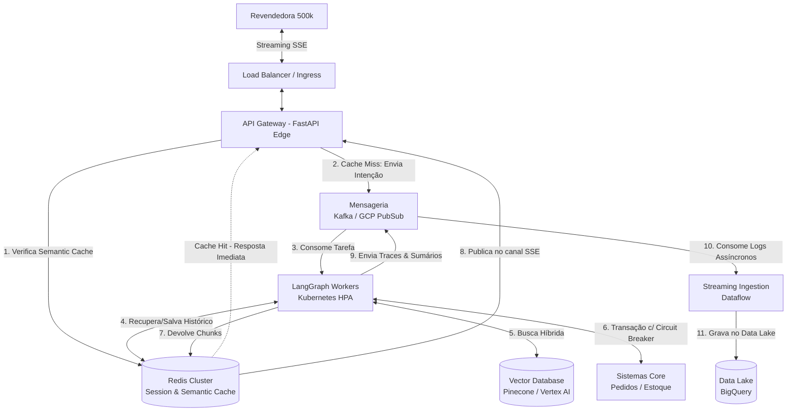

# System Design: Evolução para 500k Conexões e Data Lake

**Projeto:** Agente de Suporte à Revendedora (Plataforma Agentes GB)

**Ficheiro:** `docs/system-design-500k.md`

**Propósito:** Mapear a arquitetura TO-BE e as estratégias operacionais para suportar o crescimento até 500.000 revendedoras em simultâneo, garantindo resiliência, otimização de custos (FinOps) e integração analítica com o BigQuery[cite: 2].

## 1. Visão Executiva (Event-Driven & FinOps)
A transição do MVP para a escala de 500 mil acessos exige o abandono de uma arquitetura estritamente síncrona. O gargalo principal num sistema de agentes generativos com Streaming SSE[cite: 2] é a retenção prolongada de conexões de rede enquanto se aguarda o raciocínio do modelo. 

A arquitetura alvo (TO-BE) baseia-se no **desacoplamento via mensageria (Event-Driven)**, onde a gestão da conectividade da revendedora é separada fisicamente do processamento pesado do LangGraph[cite: 1]. Adicionalmente, introduz-se uma camada robusta de FinOps com *Semantic Routing* para mitigar custos redundantes com chamadas ao LLM principal.

## 2. Diagrama Arquitetural TO-BE (Cloud Architecture)

## 3. Matriz de Evolução (De/Para)

| Domínio Arquitetural | AS-IS (Cenário MVP) | TO-BE (Escala de 500.000 Revendedoras) | Justificativa de Negócio / Técnica |
| :--- | :--- | :--- | :--- |
| **Ponto de Entrada (API)** | FastAPI Monolítico (roteamento + processamento LangGraph na mesma instância). | **FastAPI Edge Gateway**, focado exclusivamente na manutenção de centenas de milhares de conexões SSE assíncronas[cite: 2]. | Previne a exaustão de *Workers* HTTP; liberta CPU para gestão de rede. |
| **Processamento (Motor)** | Síncrono no `app_graph.astream_events()`. | **LangGraph Workers** isolados no Kubernetes escalando horizontalmente via HPA com base na fila de mensagens (Kafka). | Permite escalar a inteligência artificial independentemente da gestão de tráfego web. |
| **Base de Conhecimento (RAG)** | ChromaDB (Local / Em memória)[cite: 1]. | **Pinecone ou Vertex AI Search** com indexação HNSW e suporte massivo a *Metadata Filtering* e Busca Híbrida. | Evita estouros de memória e garante latência sub-segundo na pesquisa semântica do catálogo. |
| **Gestão de Estado** | Checkpointer nativo em memória/SQLite[cite: 1]. | **Redis Cluster** operando memória de curto prazo (Sliding Window) com expiração via TTL de sessão. | Garante que o estado distribuído possa ser acedido por qualquer *Worker* que pegar a tarefa. |
| **Data & Observabilidade** | LangFuse Local (PostgreSQL) com logs efémeros[cite: 2]. | **Pub/Sub para Dataflow -> BigQuery**. Sumários de final de sessão e traces do LangFuse Cloud ingeridos assincronamente[cite: 2]. | Permite a criação de *dashboards* de BI e treino de modelos futuros sem onerar a latência transacional. |

## 4. Mecanismos de Defesa e Otimização (FinOps)

Para assegurar a governança de custos e a resiliência transacional, o sistema TO-BE introduz quatro barreiras de proteção:

1. **Semantic Caching:** Respostas a perguntas genéricas e repetitivas (ex: "Qual o prazo da promoção do ciclo?") são calculadas uma única vez e cacheadas vetorialmente no Redis. Se outra revendedora perguntar algo semanticamente similar, o API Gateway devolve a resposta diretamente da cache, poupando 100% do custo de inferência do LLM e do RAG.
2. **Model Cascading (Roteamento Semântico):** Um classificador ultraleve atua na borda antes de invocar o LLM Orquestrador "Heavy" (ex: Claude 3.5 Sonnet). Intenções triviais são resolvidas por modelos mais baratos (ex: Claude 3.5 Haiku ou Gemini 1.5 Flash), reservando o modelo principal apenas para orquestrações complexas entre múltiplas Tools[cite: 1].
3. **Resiliência Transacional (Circuit Breakers):** Chamadas à Tool `buscar_status_pedido`[cite: 1] são envolvidas num *Circuit Breaker*. Se o banco de dados analítico/legado do Grupo Boticário apresentar latência ou falhar repetidamente, o circuito abre-se e o agente devolve proativamente uma mensagem de "Sistema de pedidos temporariamente indisponível", evitando bloqueios nos *Workers* do LangGraph.
4. **Persistência Assíncrona (Write-Behind):** O agente não aguarda a gravação no BigQuery[cite: 2]. Todo o registo de telemetria, traces e a consolidação da "memória de longo prazo" da revendedora são despachados para um tópico de mensageria em *background* e ingeridos no data lake de forma desacoplada.